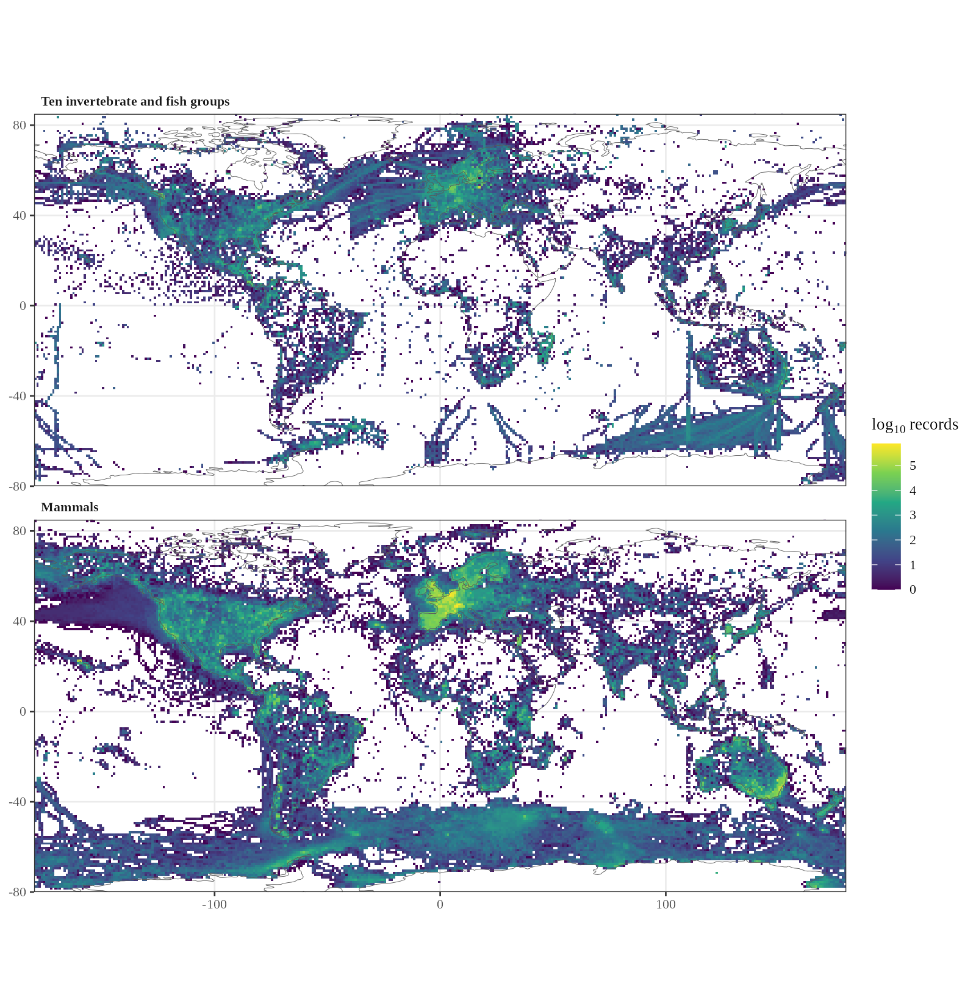
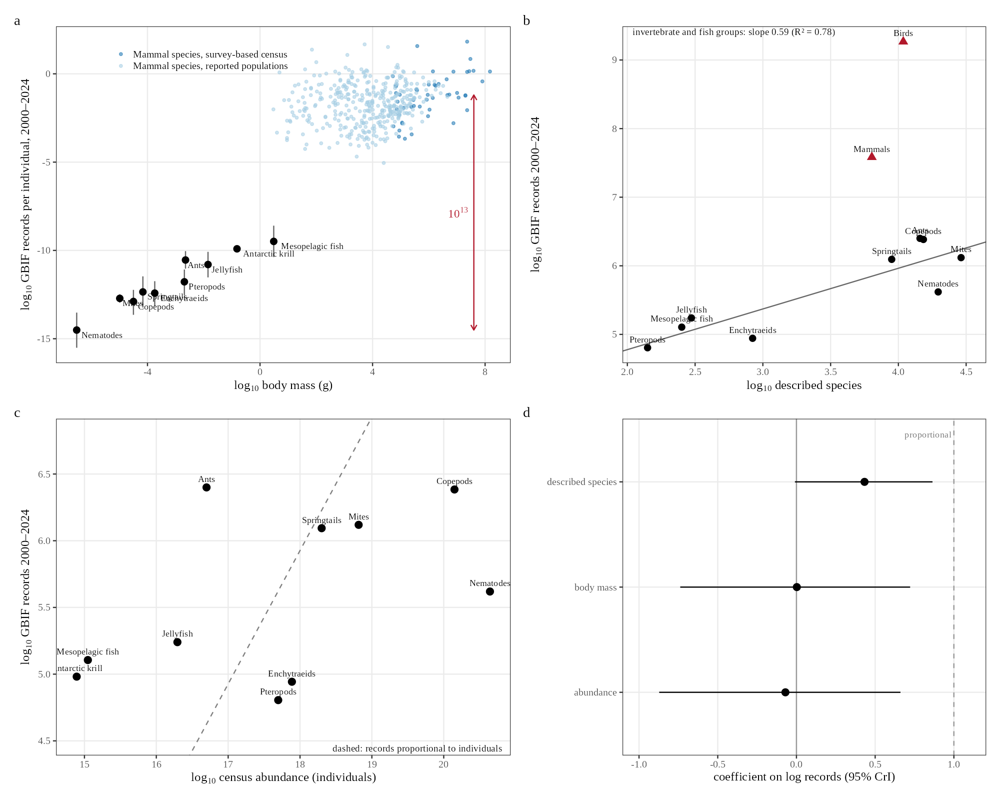
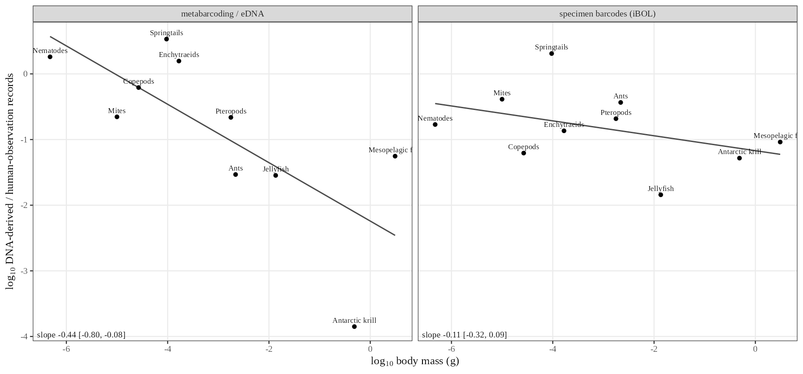
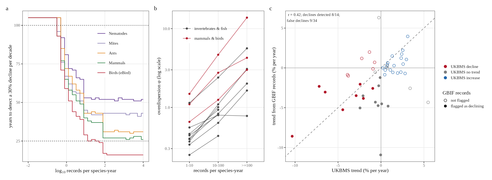
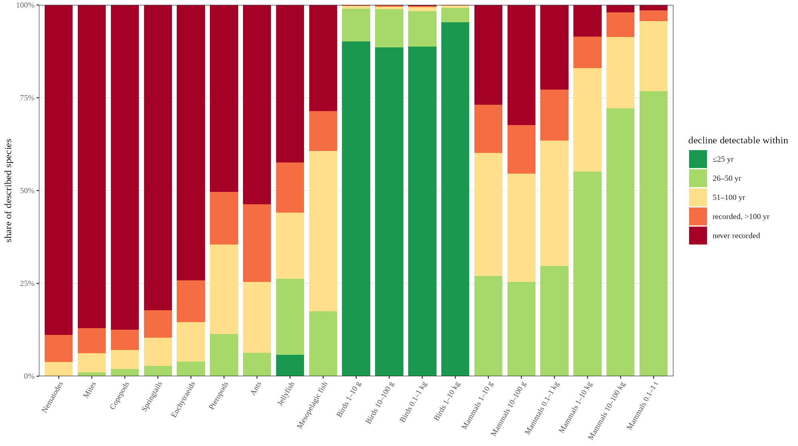

**Affiliation:** Graduate School of Informatics, Kyoto University, Yoshida-honmachi, Kyoto 606-8501, Japan

**Corresponding author:** Hideyuki Doi, doi.hideyuki.8j@kyoto-u.ac.jp

**Classification:** Biological Sciences, Ecology

**Keywords:** biodiversity monitoring, occurrence data, GBIF, detection power, body size

## Abstract

Occurrence records increasingly inform assessments of biodiversity change, yet how they are distributed relative to the abundance of animals, and which declines they can reveal, is unclear. I compared 3.89 billion GBIF records with global census abundances of ten animal groups, from soil nematodes to mesopelagic fishes. Records per individual differed by about 13 orders of magnitude between soil nematodes and mammals with survey-based censuses. This difference did not reflect how many individuals exist or how large they are: across groups, records were unrelated to abundance and body mass but increased with the number of described species. Birds and mammals received 2,000 and 50 times more records than invertebrate groups of similar species richness. Because annual record counts were overdispersed even after removing species trends, detecting a 30% decline per decade required 16 to 51 years for the most frequently recorded species, and species recorded less than about once every three years could not be detected within a century. Record-based trends of British butterflies detected 8 of 14 declines identified by structured monitoring and flagged 9 of 34 other species as declining. Across described species, 93–96% of nematode, mite and copepod species, 75% of ants and 36% of mammals, but under 1% of birds, were recorded too rarely for a decline to be detectable within 100 years. Record-based assessments therefore cannot establish whether the small animals that dominate soil and marine ecosystems are declining.

## Significance Statement

Small animals such as soil nematodes, mites and marine copepods make up most animal individuals and sustain decomposition, nutrient cycling and marine food webs, yet whether they are declining is largely unknown. Occurrence records are increasingly used to fill such gaps. Comparing billions of records with global animal counts, I show that records are allocated roughly by the number of described species rather than by abundance, and that vertebrates receive far more records than invertebrates. Because record counts fluctuate strongly between years, most small animal species are recorded too rarely for any decline to be detected within a century. An absence of detected decline in records should therefore not be read as stability.

## Introduction

Occurrence records, comprising observations, specimens and DNA detections, are aggregated by infrastructures such as the Global Biodiversity Information Facility (GBIF; https://www.gbif.org), which now serves almost four billion records [@gbif2026]. These records are increasingly used to assess how biodiversity is changing. They are also known to be biased toward particular regions, periods and taxa [@troudet2017; @hughes2021; @bowler2022; @garciarosello2023], and within groups toward larger and more conspicuous species [@callaghan2021sr; @stoudt2022]. Such biases have almost always been measured relative to the number of species. How records relate to the amount of life itself, that is, to the number of individuals that could be observed, has not been examined, because global abundance estimates for most animal groups were lacking.

This gap in knowledge matters most for small animals, because they make up the great majority of animal individuals and are the least studied. Soil nematodes alone number about 4 × 10²⁰ [@vandenhoogen2019] and soil arthropods about 10¹⁹ [@rosenberg2023]. Soil fauna drive decomposition and nutrient cycling, and the diversity and composition of soil communities underpin ecosystem multifunctionality [@bardgett2014; @wagg2014], while marine zooplankton such as copepods and krill link primary production to fishes, seabirds and whales. Changes in the abundance of these animals can therefore alter ecosystem functioning long before any species is recognised as threatened. Whether invertebrates are declining, and how fast, remains contested [@dirzo2014; @hallmann2017; @vanklink2020], and assessments increasingly draw on occurrence records [@outhwaite2020]. Knowing how well records represent small animals is therefore a precondition for interpreting what records say about them.

Recent global censuses make this comparison possible for the first time. They estimate the abundance and biomass of soil nematodes [@vandenhoogen2019], terrestrial arthropods [@rosenberg2023], springtails [@potapov2023], ants [@schultheiss2022], marine animals [@baron2018] and wild mammals [@greenspoon2023; @greenspoon2025], largely from field samples and surveys that are independent of occurrence records. Dividing records by these censuses gives the number of records per individual for groups that span many orders of magnitude in body size and abundance.

How records are distributed also determines what they can be used for, and their most consequential use is to detect population declines. Here too, much is known in principle. Simple analyses of opportunistic data can produce biased trends [@isaac2014; @isaac2015], unstructured records can miss declines that structured monitoring detects [@kamp2016], and detecting a trend in any time series takes long when its year-to-year variability is high [@taylor1993; @white2019]. What is not known is how these limits are distributed across the tree of life: for which groups, and for what share of their species, record-based trend detection is feasible at all.

I addressed both questions with the full GBIF record set and census estimates for ten animal groups. I tested two hypotheses about why records per individual differ among groups. Under a visibility hypothesis, records track the number of individuals weighted by how conspicuous they are, so that records per individual rise with body mass, approximately as projected area (body mass to the power 2/3). Under an allocation hypothesis, records track the number of species that recorders can identify, independently of how many individuals exist. I then asked how often a species must be recorded for a decline to become detectable, by simulating declining and stable record series with the variability observed in real records, and validated the result against a structured monitoring scheme. Finally, I applied the detection requirements to the observed record rate of every described species in the groups examined. The main hypotheses, models and decision criteria were preregistered; analyses added to the plan are identified in the *SI Appendix*.

## Results

### Records cover the world but differ by thirteen orders of magnitude per individual

I aggregated all 3.89 billion records of the GBIF snapshot of 1 November 2026 [@gbif2026] by taxon, year, dataset and type of record, and matched them to ten animal groups whose global abundance had been estimated independently of occurrence data or body-size allometry: soil nematodes, soil mites, copepods, springtails, enchytraeid worms, ants, pteropods, planktonic cnidarians, Antarctic krill and mesopelagic fishes (Table S1). The records of these groups from 2000 to 2024 came from all continents and oceans, covering 16,832 grid cells of 1° with coordinates, although 67% of georeferenced records lay north of 30°N; mammal records covered 27,467 cells (Fig. 1).

The abundances of the ten groups spanned 5.8 orders of magnitude (7.8 × 10¹⁴ to 4.4 × 10²⁰ individuals), whereas their records from 2000 to 2024 spanned only 1.6 orders (6.4 × 10⁴ to 2.5 × 10⁶; 8.45 million records in total). As a result, records per individual over these 25 years ranged from 9.5 × 10⁻¹⁶ for soil nematodes and 1.7 × 10⁻¹⁴ for copepods to 5.0 × 10⁻¹¹ for ants and about 1.2 × 10⁻¹⁰ for krill and mesopelagic fishes (Fig. 2A). For comparison, I used 50 mammal species whose abundances come from surveys or survey-based population models; their median was 0.064 records per individual (range 2 × 10⁻⁴ to 66), and that of 389 land mammals with reported population sizes was 0.020. An individual mammal is therefore recorded roughly 10¹³ times as often as an individual soil nematode (12.8–13.8 orders of magnitude, depending on the estimate used).

### The difference reflects allocation of records to species, not visibility

To test the visibility hypothesis, I fitted a Bayesian errors-in-variables regression of log records per individual on log body mass, which propagates the uncertainty of the census estimates into both variables. The preregistered model estimated an exponent β = 0.72 (95% credible interval [CI] 0.49–0.94), indistinguishable from the 2/3 expected from projected area, and the estimate ranged from 0.59 to 0.84 across 24 preregistered sensitivity analyses (Table S2). However, abundance and body mass were almost perfectly correlated across these groups (r = −0.96), so dividing records by abundance builds a relationship with body mass into both axes of this analysis. If records were identical in every group, the same analysis would return β = 0.89, and randomly reassigning records among groups gave 0.88 (0.69–1.08) (Table S11). The exponent therefore says nothing about how animals are detected.

I therefore modelled the number of records directly, with separate coefficients for abundance, body mass and the number of described species in the same errors-in-variables framework. Under the visibility hypothesis, the coefficient for abundance should be 1. Instead, records were unrelated to abundance (coefficient −0.07, 95% CI −0.87 to 0.66; posterior probability that it is below 1, 0.996) and to body mass (0.00, −0.74 to 0.72), but rose with the number of described species (0.43, −0.01 to 0.86; posterior probability of a positive effect 0.97; Fig. 2C and D; Table S12). The dependence on described species was steeper and more certain after correcting the taxonomic scope of nematodes, mites and mesopelagic fishes (0.48, 0.05–0.89), when counting unique sampling events instead of records (0.62, 0.15–1.08), and after removing the three largest datasets of each group (0.58, 0.29–0.89). Across the nine groups with more than one species, records scaled with described species richness to the power 0.59 (R² = 0.78; Fig. 2B).

Records are thus allocated roughly in proportion to the number of known species, not to the number of individuals. A nematode species received 0.85 records per year on average and an ant species 7.0, although there are about 9,000 times more nematodes than ants (Table S13). The difference of about 13 orders of magnitude in records per individual follows directly: small animals are vastly more numerous, but their groups receive no more records than groups of large animals with similar numbers of species.

### Vertebrates receive far more records per species

Birds and mammals received 1,900 and 54 times more records than invertebrate groups with the same number of described species (Fig. 2B), that is, 6,800 and 240 records per species per year compared with 0.85–23 in the multi-species invertebrate and fish groups (Table S13). This comparison requires no census. Within mammals, by contrast, records did track abundance: across 388 species with reported population sizes, a log–log regression showed that records scaled with abundance to the power 0.64 (SE 0.05) and with body mass to the power 0.20 (0.04) (Table S3). Records thus follow individuals within a well-studied class, but their allocation among groups follows described diversity and, for vertebrates, a large additional premium.

### DNA metabarcoding records are less biased toward large animals

DNA-derived records, those published by datasets with GBIF's DNA-derived data extension, scaled less steeply with body mass than human observations in the preregistered analysis (posterior probability 0.935; Table S2). Because that comparison shares the abundance problem described above, I also regressed the ratio of DNA-derived to human-observation records on body mass, a comparison in which abundance cancels, propagating census and residual uncertainty by Monte Carlo simulation. The ratio declined with body mass (slope −0.24 per order of magnitude, 95% interval −0.42 to −0.06). This decline was carried by metabarcoding and environmental DNA datasets (−0.44, −0.80 to −0.08), whereas specimen barcodes from the International Barcode of Life project, a single dataset contributing 45% of DNA-derived records, showed no clear trend (−0.11, −0.32 to 0.09; Fig. 3; Table S14).

### How often a species must be recorded for a decline to be detectable

I simulated annual record counts of single species as negative binomial variables declining by 30% per decade, and analysed each series with negative binomial regression including the group's total records as an effort offset, the most favourable of three methods compared. The time to detection was the shortest monitoring period in which the decline was detected with power 0.8 (one-sided α = 0.05). With overdispersion estimated from mammal records (negative binomial shape φ = 0.69, 0.66–0.71), the preregistered simulations required 43–46 years in nine of ten groups for species recorded at least 100 times per year, 49–76 years at one record per year, and 51–83 years for krill, whose recorded effort collapsed (Fig. S2). This lower limit follows analytically from the negative binomial variance: for large record rates, the time to detection T satisfies T ≈ [12(z_α + z_β)²/(φd²)]^(1/3), where d is the rate of decline, which gives 43.9 years (Table S15).

The preregistered estimate of φ, however, included genuine population trends. I therefore re-estimated φ separately for each species, using negative binomial regressions with an effort offset and a species-specific linear trend. The shape parameter φ was small, meaning strong overdispersion, for rarely recorded species and larger for frequently recorded ones (Fig. 4B; Table S16); for example, it rose from 0.66 to 3.0 in mammals and from 1.5 to 13.8 in eBird bird records between species recorded 1–10 and more than 100 times per year. With these estimates, the shortest detection times, reached by the most frequently recorded species, ranged from 16 years for eBird bird records and 26 years for mammals and copepods to 41 years for mites and 51 years for nematodes (Fig. 4A). Species with fewer than 0.25–0.4 records per year could not be detected within 100 years.

Two further properties of the data make these numbers optimistic. Residuals of record counts were autocorrelated between years (median lag-1 correlation 0.02–0.50 across groups and record rates), and with an autocorrelation of 0.44 the effort-offset method flagged false declines in 17–21% of stable series instead of 9–12% for species recorded at least ten times per year (Table S17). Within the 10-year window used by IUCN criterion A [@iucn2012], a decline would have to exceed 96% to be detected with power 0.8 at φ = 0.69, and by the time a 30% decline per decade is detected after 44 years, 79% of the population has been lost (Table S15).

### Record-based trends are unreliable even where records are rich

Simpler analyses that are widely used produced spurious trends. In the preregistered simulations without decline, relative reporting rates analysed with binomial models flagged significant declines in 45–48% of series for species recorded at least ten times per year, because such models ignore overdispersion, and raw record counts flagged significant increases in up to 41% of series where recording effort grew. The effort-offset model flagged false declines in 2–12% of series even when years were independent (Table S5).

I tested these conclusions with real data by comparing trends of 48 British butterfly species from 2000 to 2019 estimated from unstructured GBIF records with trends from the UK Butterfly Monitoring Scheme, a structured scheme of fixed transects (Fig. 4C; Table S18). This is a best case: British butterfly records are among the densest opportunistic data in the world, and their year-to-year overdispersion was much lower (median φ = 32) than in global records. Even so, record-based trends correlated only moderately with monitored trends (r = 0.42). The effort-offset method detected 8 of 14 species that declined significantly in the monitoring scheme and flagged 9 of 34 stable or increasing species as declining. Relative reporting rates detected 11 declines but flagged 20 false declines and 11 trends of the wrong sign, and raw record counts detected none.

### Most small animal species are recorded too rarely for declines to be detected

Finally, I applied the detection curves to the observed record rate (2015–2024) of every described species in each group, including species without any records. The result was a steep divide (Fig. 5; Table S19). A 30% decline per decade would remain undetectable within 100 years for 96% of nematode species, 94% of mite species and 93% of copepod species, for 90% of springtails and 85% of enchytraeids, and for 75% of ants. The share fell to 56% for jellyfish, 39% for mesopelagic fishes and 36% for mammals, and to 0.4% for birds. Most of the undetectable invertebrate species had no GBIF records at all between 2015 and 2024, including 89% of nematodes, 87% of mites and 88% of copepods. A decline would be detectable within 25 years for 89% of bird species but for almost no invertebrate species. Correcting the taxonomic scope of nematodes and mites, or using higher counts of described species [@hodda2022b], raised the undetectable share of these groups to 97–99% (Table S20).

## Discussion

Records per individual differed by about 13 orders of magnitude between soil nematodes and mammals, and this difference does not arise because large animals are easier to see. Across ten animal groups, the number of occurrence records was unrelated to how many individuals exist and rose instead with how many species have been described, so that records per individual simply mirror abundance. The size scaling that I preregistered, which matched the optical expectation of 2/3, therefore cannot be interpreted as a law of detection. Because abundance and body size are tightly linked across animal groups, the same pitfall would affect any comparison of records per individual across taxa, and I report both the preregistered estimate and the analysis that overturns its interpretation.

The positive finding is that records are allocated to species. A plausible mechanism is that a record requires identification to species, which depends on taxonomic expertise, identification keys and reference collections. These scale with described diversity rather than abundance, consistent with the known taxonomic bias of occurrence data [@troudet2017; @hughes2021] and with how a group's share of observed species grows with the number of individuals sampled [@callaghan2023]. Within mammals, where identification is rarely limiting, records did track abundance, while body size had a weak effect, consistent with the dominance of range geometry and socio-economic factors over species traits in mammal occurrence data [@meyer2016].

Vertebrates received records far beyond their species richness. Dedicated infrastructure, from eBird to photo-identification catalogues of whales, and a larger pool of observers are likely causes; within-class size effects in citizen-science data [@callaghan2021sr; @stoudt2022] are modest compared with this gap between classes. Metabarcoding and environmental DNA records were the least size-biased record type, consistent with their signal depending on biomass rather than on visibility [@yates2021]. This comparison rests on ten groups and a few large soil and plankton metabarcoding datasets, so it is partly confounded with habitat, and sequence records published to GBIF without the DNA-derived data extension, for example from GenBank, were not counted as DNA-derived.

These allocation patterns determine what records can reveal about population change. Record counts fluctuated from year to year beyond sampling noise, even after removing species trends, so the time to detect a decline shortened only slowly as records accumulated; this follows directly from overdispersion, as the analytical result shows. In practice, the time needed ranged from about 16 years for the best-recorded birds to about 50 years for the best-recorded nematodes, and was unbounded for species recorded less than once every three years. That opportunistic data yield biased or weak trends is not new [@isaac2014; @kamp2016], nor is the general dependence of trend detection on variability and duration [@taylor1993; @white2019]. The false-trend rates and the butterfly comparison confirm these results, the latter for one of the richest record sets available, and they support treating records as a nonprobability sample whose size overstates its information [@boyd2023]. The present analysis adds three things: a comparison of records with census abundances across phyla, showing that records follow described species rather than individuals; estimates of record variability across taxa and data sources, net of species trends; and a mapping of detectability onto every described species of the groups examined. More than nine in ten described nematode, mite and copepod species are recorded too rarely for a decline to be detected within a century, compared with fewer than one in a hundred bird species, and within the ten-year window of IUCN criterion A record-based detection is possible only for catastrophic declines.

These blind spots matter because of what the poorly recorded groups do. They comprise most animal individuals and a large share of animal biomass [@baron2018], and losses of soil fauna diversity reduce ecosystem multifunctionality [@wagg2014; @bardgett2014]. A decline in the abundance of nematodes, mites or springtails could therefore change decomposition and nutrient cycling without any species being listed as threatened, and such a decline would not appear in record-based assessments. The same limitation affects the debate about invertebrate decline [@hallmann2017; @vanklink2020]: for most species, occurrence records can neither confirm nor rule out the declines reported from structured surveys. Because declines are detectable mainly in large vertebrates, conservation priorities and indicators built from records will continue to favour them, not because small animals are stable but because their changes are invisible to the data.

Structured designs can do better for well-recorded species. Occupancy-detection models with repeat visits recover trends for many British invertebrates [@outhwaite2020; @vanstrien2013], and in a coarse analogue, counting occupied grid cells instead of records, overdispersion fell several-fold and detection times shortened for frequently recorded species (Fig. S3). Pooling species into multi-species indicators shortens detection further in simulations, to 10–15 years for 100 species, but these simulations assume a common trend and independent noise among species, which real indicators do not have. Neither approach can recover information about species that are almost never recorded. Global indicators such as the Living Planet Index are built from monitored vertebrate populations [@mcrae2017; @ledger2023], whose bias toward large species has also been documented nationally [@currie2022], and so they too say little about the animals examined here.

This study has limitations. The census-based analysis rests on ten groups, because few global abundance estimates are independent of occurrence data or allometry, and the assumed individual masses of five groups are crude. Records are not individuals and their units differ among datasets, although counting sampling events gave the same conclusion; duplicates across datasets were not removed, and described-species counts come from one checklist rather than group-specific catalogues, which makes the undetectable shares lower bounds. The detection simulations analyse one count per species and year with a global effort offset, whereas practitioners also use site- and visit-level occupancy models, reporting-rate models with list length and multi-year atlas comparisons [@isaac2014; @outhwaite2020], which can do better for well-recorded taxa; the simulations also treat years as independent, which the observed autocorrelation shows to be optimistic. The butterfly validation covers one taxon and one country. Finally, the preregistration was written after record totals and census values had been inspected, and several of its interpretations were overturned by later analysis; all deviations are listed in the *SI Appendix*.

These results lead to four practical conclusions. First, species-level trend claims from aggregated occurrence counts should not be made for species recorded less than about once a year, and every such claim should report the minimum decline detectable over the period used (Table S15 gives the conversion). Second, for invertebrates, structured surveys, DNA metabarcoding and, for groups with at least some records, multi-species indicators rather than single-species trends are the realistic route to trend information, extending calls to end the neglect of invertebrates in biodiversity assessments [@eisenhauer2019]. Third, publishing survey effort and non-detections together with records, for example following GBIF's guidance on the Humboldt Extension for ecological inventories, is the most direct way to move records from the count-based regime analysed here to occupancy-based designs. Fourth, the monitoring framework of the Kunming–Montreal Global Biodiversity Framework, whose goal on the abundance of wild species relies on vertebrate population indicators, should report which share of species, individuals and biomass its data represent, so that an absence of detected decline is not mistaken for stability.

## Materials and Methods

Full methods are given in the *SI Appendix*, together with the preregistration, all deviations from it, and the analyses added to it.

**Preregistration.** Hypotheses, models, priors, decision criteria, exclusion rules and sensitivity analyses were preregistered before records per individual were computed (PREREG v1.0, commit 01a2fe7, 3 November 2026, in the public repository below). The plan was written after record totals and census values had been inspected. Changes were appended with dates and reasons, and analyses added to the plan are identified in the *SI Appendix*.

**Census data.** Global abundance (N) and biomass (B) estimates were classified as independent, occurrence-derived, allometry-derived or mixed; only independent estimates entered the census analyses (Table S1). Biomass was converted to wet mass with each source's factors or a carbon-to-wet-mass ratio of 0.15 [@baron2018], and typical individual mass was M = B/N.

**Occurrence records.** All records in the GBIF snapshot of 1 November 2026 (GBIF.org, https://doi.org/10.15468/dl.jeesns; 3.89 × 10⁹ records, 3.74 × 10⁹ after excluding absences and fossils) were aggregated by taxon, year, dataset and basis of record, by species and 1° grid cell, and as unique species × dataset × 0.1° cell × date sampling events. DNA-derived records are those from datasets carrying the GBIF DNA-derived data extension, split into specimen barcodes and metabarcoding or environmental DNA. Taxonomic matching rules and scope corrections are given in Tables S1 and S20.

**Statistical models.** Records were analysed with Bayesian errors-in-variables regressions fitted in Stan [@stan2017] via cmdstanr [@gabry_cmdstanr]: ln R_g ~ Normal(a + γ ln N_g + δ ln M_g + η ln S_g, √(τ² + 1/R_g)), in which latent ln N_g and ln M_g are informed by the census estimates and their uncertainties and S_g is the number of described species. The preregistered model fixed γ = 1 and omitted S_g. Species-level mammal records were analysed with Poisson–log-normal and ordinary least-squares regressions.

**Detection.** Annual counts were simulated as negative binomial with mean λ₀E_te^(−dt) and shape φ and tested with three methods: negative binomial regression with an effort offset, a binomial model of the relative reporting rate, and negative binomial regression of raw counts. The time to detection was the shortest period with power ≥ 0.8 over 500–1,000 replicates. φ was estimated for each species from negative binomial regressions with an effort offset and a linear trend, and summarised by group and record rate. British butterfly trends were estimated from unstructured GBIF records (2000–2019) and from UK Butterfly Monitoring Scheme site indices with site fixed effects.

**AI assistance.** The analyses, code and text were developed with Claude (Anthropic), an AI system, under the author's direction. The system drafted code and text, retrieved and summarised literature and data documentation, and ran analyses. Bibliographic entries were verified against Crossref or the original documents. The author designed the study, made all analytical decisions, checked the results and takes responsibility for the content.

**Data, materials and software availability.** Code, the preregistration, derived data and internal pre-submission review reports with responses are available at https://github.com/hideyuki-doi/observation-inequality. GBIF data are cited by DOI above. Analyses used R [@rcore2026] with targets [@landau2021], arrow [@arrow_r] and brms [@burkner2017].

## Author contributions

H.D. designed research, performed research, analyzed data and wrote the paper.

## Competing interests

The author declares no competing interest.

## References

::: {#refs}
:::

## Figures

{width=100%}

**Fig. 1. Global distribution of the GBIF records analysed.** Number of records from 2000 to 2024 per 1° grid cell (log₁₀ scale) for the ten invertebrate and fish groups with independent global censuses (*Top*) and for mammals (*Bottom*). Only records with coordinates are shown (4.84 million of the 8.45 million records of the ten groups, and 36.0 million mammal records). Coastlines from Natural Earth.

{width=100%}

**Fig. 2. Records per individual and their allocation to species.** (*A*) GBIF records from 2000 to 2024 per individual against typical body mass for the ten groups with independent censuses (black; posterior medians and 95% credible intervals from the errors-in-variables model, propagating census uncertainty) and for mammal species with survey-based (dark blue) or reported (light blue) population sizes. The red arrow marks the difference between soil nematodes and the median of mammals with survey-based censuses. (*B*) Records against the number of described species for the invertebrate and fish groups (circles; line, least-squares fit with slope 0.59 and R² = 0.78) and for birds and mammals (triangles). (*C*) Records against census abundance for the ten groups; the dashed line shows the relationship expected if records were proportional to the number of individuals. (*D*) Coefficients (posterior medians and 95% credible intervals) of an errors-in-variables regression of log records on log abundance, log body mass and log number of described species; a coefficient of 1 for abundance (dashed line) would mean records proportional to individuals.

{width=100%}

**Fig. 3. DNA-derived records relative to human observations.** Log ratio of DNA-derived to human-observation records against typical body mass for the ten groups, for metabarcoding and environmental DNA datasets (*Left*) and specimen barcodes of the International Barcode of Life project (*Right*). Abundance cancels in the ratio. Lines are least-squares fits; slopes and 95% intervals (in panels) propagate census uncertainty and residual uncertainty by Monte Carlo simulation.

{width=100%}

**Fig. 4. Detecting declines from occurrence records.** (*A*) Simulated years needed to detect a 30% decline per decade with power 0.8 (one-sided α = 0.05; negative binomial regression with an effort offset; constant effort) against the expected number of records per species and year, using overdispersion estimated for each group and record rate after removing species-specific trends. Lines at the top denote no detection within 100 years; dotted lines mark 25 and 100 years. (*B*) Overdispersion parameter φ of annual record counts by record rate, estimated per species with an effort offset and a linear trend, for invertebrate and fish groups (grey) and for mammals and birds (red); larger φ means less overdispersion. (*C*) Trends of 48 British butterfly species from 2000 to 2019 estimated from unstructured GBIF records (negative binomial regression with an effort offset) against trends from the UK Butterfly Monitoring Scheme; colours show the significance of the monitoring trend and filled symbols the species flagged as declining from records. The dashed line is the 1:1 line; the correlation coefficient and detection rates are given in the panel.

{width=100%}

**Fig. 5. Share of described species whose declines are detectable.** For every described species, the time needed to detect a 30% decline per decade was derived from its observed GBIF record rate (2015–2024; zero for species without records) and the curves in Fig. 4A. Bars show the share of described species detectable within 25, 50 or 100 years, recorded but undetectable within 100 years, or never recorded. Invertebrate and fish groups are ordered by typical body mass; birds and mammals are divided into body-mass classes.
