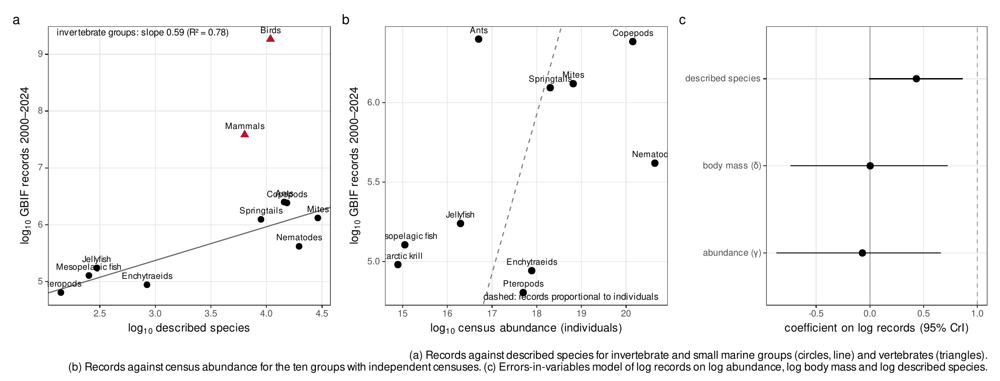
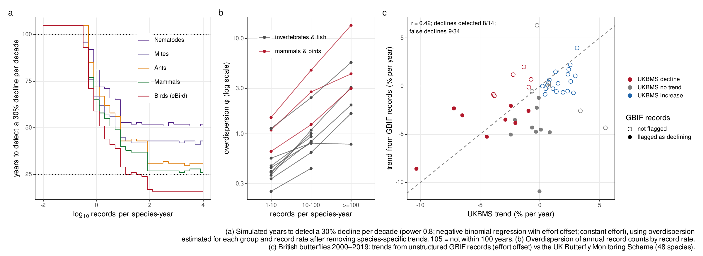
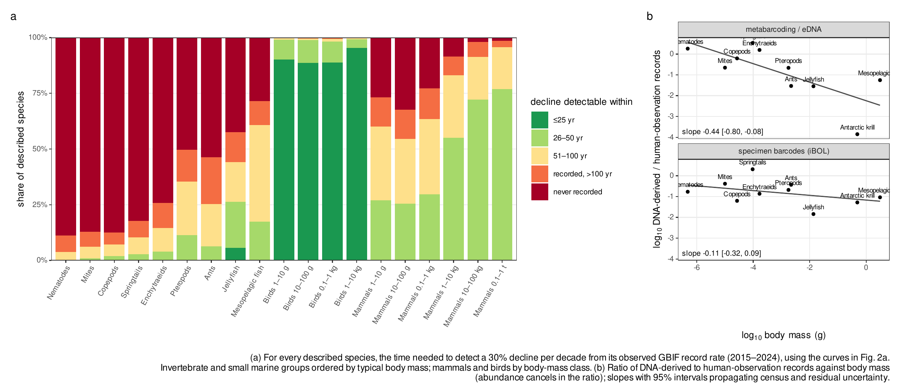

**Author affiliation:** Kyoto University, Kyoto, Japan [department to be confirmed]

**Corresponding author:** Hideyuki Doi, doi.hideyuki.8j@kyoto-u.ac.jp

**Classification:** Biological Sciences, Ecology

**Keywords:** biodiversity monitoring, occurrence data, GBIF, detection power, body size

## Abstract

Occurrence records are increasingly used to judge whether species are declining, yet how records are distributed relative to how much life exists, and what this allows us to detect, is unclear. I compared 3.89 billion GBIF records with global census abundances of ten animal groups spanning six orders of magnitude in abundance. A preregistered body-size exponent of records per individual (0.72) proved to be a ratio artefact: in exploratory models, records were unrelated to the number of individuals or to body mass but rose with the number of described species. Birds and mammals received 2,000 and 50 times more records than invertebrate groups of equal species richness, and DNA metabarcoding records were less biased toward large animals than human observations. Annual record counts were overdispersed even after removing species trends, so detecting a 30% decline per decade took, in exploratory simulations, 16 years for the most frequently recorded birds and 51 years for the most frequently recorded nematodes, and species with fewer than about 0.3 records per year were undetectable within a century. Against structured monitoring, record-based trends of British butterflies detected 8 of 14 declines and falsely flagged 9 of 34 other species (exploratory). In exploratory analyses of all described species, 93–96% of nematode, mite and copepod species, 75% of ants and 36% of mammals, but under 1% of birds, were recorded too rarely for a decline to be detectable within 100 years. An absence of detected decline in records says little about most animal species.

## Significance Statement

Occurrence records are often used to ask whether species are declining. Comparing billions of records with global counts of animals, I show that records are allocated roughly by the number of known species in a group, not by how many individuals exist, and that vertebrates receive far more records than invertebrates with similar numbers of species. Because yearly record counts fluctuate strongly, detecting a 30% decline over a decade takes decades even for well-recorded species, and record-based trends agreed poorly with structured monitoring. More than nine in ten described nematode, mite and copepod species are recorded too rarely for any decline to be detected within a century. Records alone cannot tell us whether most small animals are declining.

## Introduction

Occurrence records, comprising observations, specimens and DNA detections aggregated by infrastructures such as the Global Biodiversity Information Facility (GBIF), are increasingly used to assess biodiversity change. They are known to be biased toward particular regions, periods and taxa [@troudet2017; @hughes2021; @bowler2022; @garciarosello2023], and within groups toward larger and more conspicuous species [@callaghan2021sr; @stoudt2022]. These biases are usually measured relative to species richness. Whether records are proportionate to the amount of life itself, the number of individuals that could be observed, has not been tested, because global abundance estimates for most groups were lacking.

Global censuses now provide such estimates for soil nematodes [@vandenhoogen2019], terrestrial arthropods [@rosenberg2023], springtails [@potapov2023], ants [@schultheiss2022], marine animals [@baron2018] and wild mammals [@greenspoon2023; @greenspoon2025]. Combined with occurrence records, they allow three questions to be asked across very different organisms. Do records scale with the number of individuals, with body size, or with something else? How often must a species be recorded for a decline to become detectable? And what share of species meets that requirement?

The second question matters because records are used to infer declines. Simple analyses of opportunistic data can produce biased trends [@isaac2014; @isaac2015], unstructured records can miss declines that structured monitoring detects [@kamp2016], and detecting trends in any time series requires long monitoring when variability is high [@white2019]. How these limits play out across the tree of life has not been examined.

I combined the full GBIF record set with census estimates for ten animal groups. Following a preregistered plan, I estimated how records relate to abundance and body size and simulated how long declines take to become detectable. In response to peer review, I tested whether the preregistered relationship between records per individual and body mass was identifiable, re-estimated record variability after removing species trends, and validated record-based trends against a structured monitoring scheme. Analyses beyond the preregistration are labelled exploratory.

## Results

### Records follow species, not individuals

The ten groups with census abundances estimated independently of occurrence data or body-size allometry were soil nematodes, soil mites, copepods, springtails, enchytraeid worms, ants, pteropods, planktonic cnidarians, Antarctic krill and mesopelagic fishes (Table S1). Their abundances spanned 5.8 orders of magnitude (7.8 × 10¹⁴ to 4.4 × 10²⁰ individuals), while their GBIF records from 2000 to 2024 spanned only 1.6 orders (6.4 × 10⁴ to 2.5 × 10⁶; 8.45 million records in total).

The preregistered analysis regressed records per individual on body mass and estimated an exponent β = 0.72 (95% credible interval [CrI] 0.49–0.94), which by the preregistered criteria indicated scaling with limited precision, indistinguishable from the 2/3 expected if detectability tracked projected area, and ranged from 0.59 to 0.84 across 24 preregistered sensitivity analyses (Table S2). However, abundance and body mass were almost perfectly correlated across these groups (r = −0.96), so dividing records by abundance builds a relationship with body mass into both axes. If records were identical in every group, the same analysis would return β = 0.89, and randomly reassigning records among groups gave 0.88 (0.69–1.08) (Table S11). The preregistered exponent therefore cannot be attributed to how organisms are detected.

When records were modelled directly (exploratory), allowing separate coefficients for abundance, body mass and described species richness while propagating census uncertainty, records were unrelated to abundance (coefficient −0.07, 95% CrI −0.87 to 0.66; posterior probability that it is below 1, the value expected if records tracked individuals, 0.996) and to body mass (0.00, −0.74 to 0.72), but rose with the number of described species (0.43, −0.01 to 0.86; posterior probability of a positive effect 0.97; Fig. 1B,C; Table S12). The relationship with described species was steeper and more certain after correcting the taxonomic scope of nematodes, mites and mesopelagic fishes (0.48, 0.05–0.89), when counting unique sampling events instead of records (0.62, 0.15–1.08), and after removing the three largest datasets of each group (0.58, 0.29–0.89). Across the nine groups with more than one species, records scaled with described species richness to the power 0.59 (R² = 0.78; Fig. 1A).

Records are thus allocated roughly in proportion to the number of known species, not to the number of individuals: a nematode species received 0.85 records per year on average and an ant species 7.0, although there are about 9,000 times more nematodes than ants (Table S13).

### Vertebrates receive far more records per species

Birds and mammals received 1,900 and 54 times more records than invertebrate groups with the same number of described species (Fig. 1A; descriptive, requiring no census), or 6,800 and 240 records per species per year compared with 0.85–23 in the multi-species invertebrate and fish groups (Table S13). Within mammals, by contrast, records did track abundance (exploratory): across 388 species with reported population sizes, records scaled with abundance to the power 0.64 (SE 0.05) and with body mass to the power 0.20 (0.04) (Table S3). Records follow individuals within a well-studied class, but the allocation of records among groups follows described diversity and, for vertebrates, a large additional premium.

### DNA metabarcoding records are less size-biased

In the preregistered analysis, DNA-derived records scaled less steeply with body mass than human observations (posterior probability 0.935; Table S2). This comparison shares the abundance artefact, so I also modelled the ratio of DNA-derived to human-observation records, in which abundance cancels (exploratory). The ratio declined with body mass (slope −0.24 per order of magnitude, 95% interval −0.42 to −0.06). The decline was carried by metabarcoding and environmental DNA datasets (−0.44, −0.80 to −0.08), whereas specimen barcodes from the International Barcode of Life project, a single dataset contributing 45% of DNA-derived records, showed no clear trend (−0.11, −0.32 to 0.09; Fig. 3B; Table S14).

### How often a species must be recorded for a decline to be detectable

The variability of annual record counts determines how long a decline takes to become detectable. In the preregistered simulations, overdispersion estimated from mammal records (negative binomial shape φ = 0.69, 0.66–0.71) implied that detecting a 30% decline per decade with power 0.8, using negative binomial regression with an effort offset, took 43–46 years in nine of ten groups for species recorded at least 100 times per year, 49–76 years at one record per year, and 51–83 years for krill, whose recorded effort collapsed (Fig. S2). This floor follows analytically from the negative binomial variance: for large record rates, T ≈ [12(z_α + z_β)²/(φd²)]^(1/3), which gives 43.9 years (Table S15).

The preregistered estimate of φ, however, included genuine population trends. Re-estimated for each species with an effort offset and a species-specific trend (exploratory), the shape parameter φ was small, meaning strong overdispersion, for rarely recorded species and larger for frequently recorded ones (Fig. 2B; Table S16). For example, φ rose from 0.66 to 3.0 in mammals and from 1.5 to 13.8 in eBird bird records between species recorded 1–10 and more than 100 times per year. Using these estimates, the shortest detection times, reached by the most frequently recorded species, ranged from 16 years for eBird bird records and 26 years for mammals and copepods to 41 years for mites and 51 years for nematodes (Fig. 2A). Species with fewer than 0.25–0.4 records per year could not be detected within 100 years.

Two further properties of the data worsen these numbers. Residuals of record counts were autocorrelated between years (median lag-1 correlation 0.02–0.50 across groups and record rates), and with an autocorrelation of 0.44 the effort-offset method flagged false declines in 17–21% of stable series rather than 9–12% for species recorded at least ten times per year (5–8% rising to 9–12% at one record per year; Table S17). Within the 10-year window used by IUCN criterion A [@iucn2012], a decline would have to exceed 96% to be detected with power 0.8 at φ = 0.69, and by the time a 30%-per-decade decline is detected after 44 years, 79% of the population has been lost (Table S15).

### Record-based trends agree poorly with structured monitoring

To test these conclusions with data, I compared trends of 48 British butterfly species from 2000 to 2019 estimated from unstructured GBIF records with trends from the UK Butterfly Monitoring Scheme (exploratory; Fig. 2C; Table S18). This is a best case: British butterfly records are among the densest opportunistic data in the world, and their year-to-year overdispersion was much lower (median φ = 32) than in global records.

Record-based trends correlated only moderately with monitored trends (r = 0.42). The effort-offset method detected 8 of 14 species declining significantly in the monitoring scheme and flagged 9 of 34 stable or increasing species as declining. Relative reporting rates detected 11 declines but flagged 20 false declines and 11 trends of the wrong sign; raw record counts detected none.

### Most small animal species are recorded too rarely for declines to be detected

Applying the detection curves to the observed record rate of every described species (exploratory) showed a steep divide (Fig. 3A; Table S19). A 30% decline per decade would remain undetectable within 100 years for:

- 96% of nematode species, 94% of mite species and 93% of copepod species
- 90% of springtails and 85% of enchytraeids
- 75% of ants
- 56% of jellyfish and 39% of mesopelagic fishes
- 36% of mammals
- 0.4% of birds

Most of these species had no GBIF records at all between 2015 and 2024: 89% of nematodes, 87% of mites and 88% of copepods. A decline would be detectable within 25 years for 89% of bird species and for almost no invertebrate species. Correcting the taxonomic scope of nematodes and mites, or using higher counts of described species [@hodda2022b], raised the undetectable share of these groups to 97–99% (Table S20).

### Simple analyses produce spurious trends

In preregistered simulations without decline, relative reporting rates analysed with binomial models flagged significant declines in 45–48% of series for species recorded at least ten times per year, because they ignore overdispersion. Raw record counts flagged significant increases in up to 41% of series where recording effort grew. The effort-offset model flagged false declines in 2–12% of series even with independent years (Table S5).

## Discussion

Across ten animal groups, the number of occurrence records was unrelated to how many individuals exist and rose instead with how many species have been described. Records per individual therefore mirror abundance, and the size scaling that I preregistered, which matched the optical expectation of 2/3, cannot be interpreted as a law of detection. Reviewers identified this ratio artefact; it reverses the interpretation of the preregistered analysis, and I report both.

The positive finding is that records are allocated to species. A plausible mechanism is that records require identification to species, which depends on taxonomic expertise, keys and reference collections. These scale with described diversity rather than abundance, a point consistent with the known taxonomic bias of occurrence data [@troudet2017; @hughes2021] and with how a group's share of observed species grows with the number of individuals sampled [@callaghan2023]. Within mammals, where identification is not limiting, records did track abundance, while body size had a weak effect, consistent with the dominance of range geometry and socio-economic factors over species traits in mammal occurrence data [@meyer2016].

Vertebrates received records far beyond their species richness. Dedicated infrastructure, from eBird to photo-identification catalogues of whales, and a larger pool of observers are likely causes; within-class size effects in citizen-science data [@callaghan2021sr; @stoudt2022] are modest compared with this gap between classes. Metabarcoding and environmental DNA records were the least size-biased record type, consistent with their signal depending on biomass rather than on visibility [@yates2021]. This comparison rests on ten groups and a few large soil and plankton metabarcoding datasets, so it is partly confounded with habitat, and sequence records published to GBIF without the DNA-derived data extension (for example from GenBank) were not counted as DNA-derived.

These allocation patterns matter because they determine what records can reveal about population change. Record counts fluctuated from year to year beyond sampling noise, even after removing species trends, so the time to detect a decline shortened only slowly as records accumulated. This is a direct consequence of overdispersion, which I derive analytically. Its practical meaning is that the time needed ranges from about 16 years for the best-recorded birds to about 50 years for the best-recorded nematodes, and is unbounded for species recorded less than once every three years.

That opportunistic data yield biased or weak trends is not new [@isaac2014; @kamp2016], nor is the general dependence of trend detection on variability and duration [@taylor1993; @white2019]; the false-trend rates and the butterfly comparison confirm these results, the latter for one of the richest record sets available, and records are best understood as a nonprobability sample whose size overstates its information [@boyd2023]. What the present analysis adds is new in three respects: records were compared with census abundances across phyla, showing that they follow described species rather than individuals; record variability was estimated across taxa and data sources, net of species trends; and detectability was mapped onto every described species of the groups examined. More than nine in ten described nematode, mite and copepod species are recorded too rarely for a decline to be detected within a century, against fewer than one in a hundred bird species. Within the ten-year window of IUCN criterion A, record-based detection is possible only for catastrophic declines.

Structured designs can do better for well-recorded species. Occupancy-detection models with repeat visits recover trends for many British invertebrates [@outhwaite2020; @vanstrien2013]; in my coarse analogue, counting occupied grid cells, overdispersion fell several-fold and detection times shortened for frequently recorded species (Fig. S3). Pooling species into multi-species indicators shortens detection further in simulations (to 10–15 years for 100 species), but these assume a common trend and independent noise among species, which real indicators do not have. Neither approach can recover information about species that are almost never recorded. Global indicators such as the Living Planet Index are built from monitored vertebrate populations [@mcrae2017; @ledger2023] whose size skew has also been documented nationally [@currie2022], and so they too say little about the animals examined here.

This study has limitations. The census-based analysis rests on ten groups because few global abundance estimates are independent of occurrence data or allometry, and the assumed individual masses of five groups are crude. Records are not individuals and their units differ among datasets, although counting sampling events gave the same conclusion; duplicates across datasets were not removed, and described-species counts come from one checklist rather than group-specific catalogues, which makes the undetectable shares lower bounds. The detection simulations analyse one count per species and year with a global effort offset; practitioners use site- and visit-level occupancy models, reporting-rate models with list length, and multi-year atlas comparisons [@isaac2014; @outhwaite2020], which can do better for well-recorded taxa. The simulations also treat years as independent, which autocorrelation shows to be optimistic. The butterfly validation covers one taxon and one country. Finally, the preregistration was written after record totals and census values had been inspected, and several of its interpretations were overturned in review; all deviations are listed in the *SI Appendix*.

Four practical conclusions follow. First, species-level trend claims from aggregated occurrence counts should not be made for species recorded less than about once a year, and every claim should report the minimum decline detectable over the period used (Table S15 gives the conversion). Second, for invertebrates, structured surveys, DNA metabarcoding and, for groups with at least some records, multi-species indicators rather than single-species trends are the realistic route to trend information, extending calls to end the neglect of invertebrates in assessments [@eisenhauer2019]. Third, publishing survey effort and non-detections with records, for example through GBIF's guidance on the Humboldt Extension for ecological inventories, is the cheapest way to move records from the count-based regime analysed here to occupancy-based designs. Fourth, the monitoring framework of the Kunming–Montreal Global Biodiversity Framework, whose goal on the abundance of wild species relies on vertebrate population indicators, should report which share of species, individuals and biomass its data represent, so that an absence of detected decline is not mistaken for stability.

## Materials and Methods

Full methods are given in the *SI Appendix*, together with the preregistration (English translation), all deviations, and the review-driven analyses.

**Preregistration.** Hypotheses, models, priors, decision criteria, exclusion rules and sensitivity analyses were preregistered before records per individual were computed (PREREG v1.0, commit 01a2fe7, 3 November 2026, in the public repository below). The plan was written after record totals and census values had been inspected. Changes were appended with dates and reasons.

**Census data.** Global abundance (N) and biomass (B) estimates were classified as independent, occurrence-derived, allometry-derived or mixed; only independent estimates entered the census analyses (Table S1). Biomass was converted to wet mass with each source's factors or a carbon-to-wet-mass ratio of 0.15 [@baron2018], and M = B/N.

**Occurrence records.** All records in the GBIF snapshot of 1 November 2026 (GBIF.org, https://doi.org/10.15468/dl.jeesns; 3.89 × 10⁹ records, 3.74 × 10⁹ after excluding absences and fossils) were aggregated by taxon, year, dataset and basis of record. They were also aggregated as unique species × dataset × 0.1° cell × date sampling events. DNA-derived records are those from datasets carrying the GBIF DNA-derived data extension, split into specimen barcodes (iBOL) and metabarcoding or environmental DNA. Taxonomic matching rules and scope corrections are in Tables S1 and S20.

**Models.** Records were modelled with errors-in-variables regressions in Stan [@stan2017] via cmdstanr [@gabry_cmdstanr]: ln R_g ~ Normal(a + γ ln N_g + δ ln M_g + η ln S_g, √(τ² + 1/R_g)), with latent ln N_g and ln M_g informed by census observations and their uncertainties. The preregistered model fixed γ = 1.

**Detection.** Annual counts were simulated as negative binomial with mean λ₀E_te^(−dt) and shape φ, and tested with three methods; the time to detection was the shortest period with power ≥ 0.8 over 500–1,000 replicates. φ was estimated per species from negative binomial regressions with an effort offset and a linear trend, summarised by group and record rate. British butterfly trends were estimated from unstructured GBIF records (2000–2019) and from UK Butterfly Monitoring Scheme site indices with site fixed effects.

**AI assistance.** The analyses, code and text were developed with Claude (Anthropic), an AI system, under the author's direction. The system drafted code and text, retrieved and summarised literature and data documentation, and ran analyses. Bibliographic entries were verified against Crossref or the original documents. The author designed the study, made all analytical decisions, checked the results and takes responsibility for the content.

**Data, materials and software availability.** Code, the preregistration (with English translation), derived data, review reports and responses are available at https://github.com/hideyuki-doi/observation-inequality (to be archived on Zenodo with a DOI on acceptance). GBIF data are cited by DOI above. Analyses used R [@rcore2026] with targets [@landau2021], arrow [@arrow_r] and brms [@burkner2017].

## Author contributions

H.D. designed research, performed research, analyzed data and wrote the paper.

## Competing interests

The author declares no competing interest.

## Figure legends

**Fig. 1. Records follow species, not individuals.** (*A*) Descriptive: GBIF records (2000–2024) against the number of described species for invertebrate and small marine groups (circles; line, slope 0.59) and for birds and mammals (triangles). (*B*) Records against census abundance for the ten groups with independent censuses; the dashed line shows proportionality to individuals. (*C*) Exploratory: coefficients (posterior medians and 95% CrI) of an errors-in-variables model of log records on log abundance, log body mass and log described species.

**Fig. 2. Detecting declines from occurrence records (exploratory).** (*A*) Simulated years to detect a 30% decline per decade (power 0.8; negative binomial regression with an effort offset; constant effort) against records per species and year, using overdispersion estimated for each group and record rate after removing species-specific trends. Lines at the top denote no detection within 100 years. (*B*) Overdispersion of annual record counts by record rate, for invertebrate and fish groups (grey) and mammals and birds (red). (*C*) Trends of 48 British butterfly species from unstructured GBIF records against trends from the UK Butterfly Monitoring Scheme, 2000–2019.

**Fig. 3. Which species' declines are detectable (exploratory).** (*A*) Share of described species by the time within which a 30% decline per decade would be detected, given each species' observed record rate (2015–2024) and the curves in Fig. 2A. (*B*) Ratio of DNA-derived to human-observation records against body mass for metabarcoding and environmental DNA (top) and specimen barcodes (bottom); abundance cancels in the ratio.

## Figures

{width=100%}

{width=100%}

{width=100%}

## References
