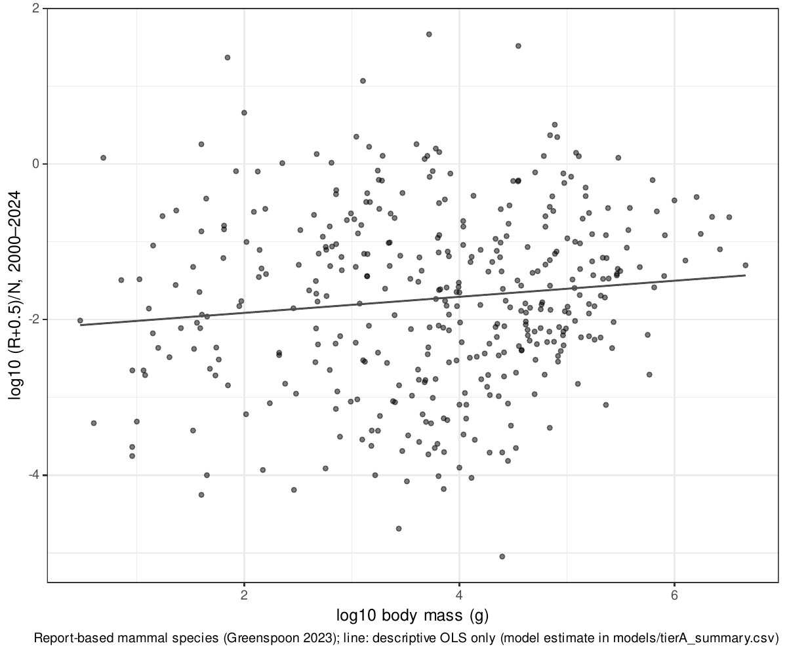

## Supplementary Methods

### Preregistration

Before any records-per-individual value was computed, I fixed the analysis plan in a preregistration (PREREG v1.0, 3 November 2026). It covers:
- the data versions, model equations and priors
- decision criteria for each hypothesis
- exclusion rules
- 15 sensitivity analyses

Later changes were only appended, each with its date and reason. These include:
- implementation changes to the species-level model and to the detection simulations (described below)
- an addendum on interpreting H3

All analyses outside the plan are reported as exploratory.

### Global census data

**Sources.** I compiled global estimates of abundance (N) and biomass (B) for animal groups from:
- Bar-On et al. 2018 (data repository, commit 36cf0a8)
- van den Hoogen et al. 2019
- Rosenberg et al. 2023
- Potapov et al. 2023
- Schultheiss et al. 2022
- Atkinson et al. 2009
- Irigoien et al. 2014
- Greenspoon et al. 2023 and 2025
- Callaghan et al. 2021

For each estimate I recorded the source location, uncertainty and estimation method.

**Method classes.** I classified each estimate as one of four types:
- **independent:** extrapolated from field samples such as soil cores, net hauls, acoustic or aerial surveys, or population models fitted to catch and survey data
- **occurrence-derived:** using citizen-science or other occurrence data
- **allometry-derived:** density predicted from body size or other traits
- **mixed**

Only independent estimates entered the main analysis, because occurrence- or allometry-derived abundances would build the tested relationship into the data.

Two classifications mattered most:
- **Birds:** the only species-level global bird abundances (Callaghan et al. 2021) predict every species' density from eBird data, so I classed them as occurrence-derived.
- **Land mammals:** for 92% of species, abundance in Greenspoon et al. 2023 comes from a support-vector regression with body mass among its predictors, so I classed those as allometry-derived.

**Main analysis groups.** Ten groups met the criterion and were analysed:
- soil nematodes (van den Hoogen et al. 2019)
- springtails (Potapov et al. 2023)
- soil mites, derived by rerunning the Rosenberg et al. 2023 code with a fixed seed
- non-arboreal ants (Rosenberg et al. 2023)
- Antarctic krill (Atkinson et al. 2009)
- five groups from Bar-On et al. 2018: enchytraeids, copepods, pteropods, planktonic cnidarians and mesopelagic fishes

For the five Bar-On groups, abundance is biomass divided by an assumed individual mass. I therefore realigned biomass to the subgroup the abundance refers to, and treated the assumed mass as an observation (see the model below).

**Units.** Biomass was converted to wet mass using each source's own factors where given: Rosenberg et al. dry-to-wet ratios, and the Potapov et al. carbon-to-fresh-mass equivalence. Otherwise I used the carbon-to-wet-mass ratio of 0.15 that Bar-On et al. 2018 applied to animals. Typical individual mass was M = B/N.

**Uncertainty.** I converted every census uncertainty to a log-normal standard deviation:
- 95% intervals and reported ranges: σ = (ln hi − ln lo)/3.92
- fold uncertainty f: σ = ln f / 1.96
- no reported uncertainty: a default fold of 10, with an assumed individual mass given fold 3, both varied in sensitivity analyses

### Occurrence records

**GBIF.** I aggregated all records from the GBIF public monthly snapshot of 1 November 2026: 10,346 Parquet files, 3.75 × 10⁹ records, read with the R package arrow from the AWS open-data buckets. Records were counted by taxon, year, basis of record and dataset class. I excluded records with occurrenceStatus = ABSENT and fossil specimens.

**Record types.** Dataset classes were taken from the GBIF API: eBird, iNaturalist research-grade, and datasets with the DNA-derived data extension. I defined four record types:
- human observation
- preserved specimen
- DNA-derived (records from datasets with the DNA-derived data extension)
- all records

I did not treat MATERIAL_SAMPLE as DNA-derived. Many such records are non-genetic net samples; 87% of Antarctic krill records, for example.

**Taxonomy.** The snapshot uses the Catalogue of Life eXtended Release taxonomy. Census groups were matched to GBIF taxa by explicit rules: phylum Nematoda, class Collembola, three mite orders, family Formicidae, family Enchytraeidae, class Copepoda, order Pteropoda, classes Scyphozoa and Cubozoa, family Myctophidae, and *Euphausia superba*. Species-level census names were resolved to accepted names with the GBIF species-matching service. The response R was the number of records from 2000 to 2024.

**BOLD.** I also obtained barcode record counts from the BOLD portal API.

### Scaling model (main analysis)

I fitted an errors-in-variables model in Stan (CmdStan 2.40 via cmdstanr). Each group g has latent abundance ln N_g and individual mass ln M_g. Census observations inform N, B = N·M, or the assumed mass M, each with the standard deviation above.

Records of type k were modelled as

ln R_gk ~ Normal(ln N_g + a_k + b_k (ln M_g − c), √(τ_k² + 1/R_gk)),

where c is the mean observed ln M and the 1/R_gk term approximates Poisson variance. A Poisson likelihood mixed poorly in parameter-recovery tests because counts are large (all R > 10³).

**Priors:**
- b ~ N(0, 2)
- a ~ N(−25, 10)
- τ ~ Half-Normal(0, 2)
- weakly informative priors on latent N and M

**Sampling and diagnostics.** I ran four chains of 1,000 warm-up and 1,000 sampling iterations with adapt_delta = 0.99. Convergence required R̂ < 1.01 and bulk and tail ESS > 400. Simulated datasets mimicking the census structure recovered true slopes of 0.67, 1 and 1.5.

**Decision criteria (preregistered):**
- **H1:** "clean scaling" if the 95% interval of β = b_all is narrower than 0.3 and the Bayesian R² exceeds 0.7, with a secondary description of "scaling with limited precision" for widths below 0.6.
- **H2:** "human interest dominant" if P(β − 2/3 > 0.2) > 0.95, and "flatter than optical" for the mirror case.
- **H4:** supported if P(b_DNA < b_human) > 0.9.

**Sensitivity analyses (preregistered):**
- cumulative records
- individualCount weighting
- species-level records only
- alternative census sources
- alternative taxon matching
- default uncertainty folds of 5 and 20
- alternative carbon-to-wet conversion
- adding occurrence- or allometry-derived groups (birds, mammals)
- leave-one-group-out
- excluding iNaturalist, or using iNaturalist only
- adding prokaryotes
- Monte Carlo propagation with ordinary regression instead of the errors-in-variables model
- a strict DNA definition

### Species-level models

**Data.** For mammals with reported population sizes in Greenspoon et al. 2023 (388 species after merging names that resolve to the same accepted species), I modelled species record counts R_s (2000–2024). Body masses came from COMBINE (Soria et al. 2021).

**Model.** The model was Poisson–log-normal:

log λ_s = ln N̂_s + α + β ln M_s + u_order + ε_s.

**Deviation from the plan.** The plan specified a brms model with measurement error on ln N. It mixed poorly because each species contributes one count. The measurement error on ln N and the residual ε are independent Gaussian terms entering the linear predictor additively, so I combined them into a single term with SD √(sdN² + τ²). I fitted this equivalent model directly in Stan with a centred parameterisation.

**Sensitivity analyses** used all 4,795 Greenspoon species, and the Callaghan et al. 2021 birds with AVONET masses (Tobias et al. 2022).

### Detection simulations

**Overdispersion.** I estimated the negative-binomial shape φ from yearly record counts of the report-based mammals, using a model with species and year fixed effects (brms).

**Simulated series.** Species series were simulated as y_t ~ NegBin(λ₀ E_t e^{−dt}, φ), with a 30% decline per decade (d = −ln 0.7/10) or no decline. E_t was the observed effort trajectory of each group from 2000 to 2024, held constant thereafter.

**Analysis methods compared:**
- (a) negative-binomial regression with log effort as offset
- (b) relative reporting rate tested with a binomial model, the denominator being the group's other records
- (c) negative-binomial regression on raw counts

Tests were one-sided at α = 0.05.

**Time to detection.** T_detect was the shortest monitoring period with power ≥ 0.8 over 1,000 replicates. It was found by bisection over 3–100 years, assuming power increases with T, and evaluated for 36 values of λ₀ between 10⁻² and 10⁵. Bisection replaced the planned evaluation of every T because evaluating every T would have required about 10⁸ model fits.

**Mapping to body mass.** I combined the scaling model's posterior with log-normal species abundance distributions (log₁₀ SD = 1.5; 1 and 2 in sensitivity analyses) and the described species richness of each group.

### Exploratory analyses

**Observed record rates.** For every described species in each group, I took λ as the mean annual GBIF records from 2015 to 2024, setting λ = 0 for described species without records. These values were compared with detection thresholds under constant effort (Fig. 2b).

Overdispersion for invertebrate groups was estimated by the same species-plus-year model in three record-rate strata. Up to 300 species were sampled per stratum.

**Occupancy-based index.** I re-aggregated the snapshot with coordinates into species × 1° cell × year. I then compared φ, and the resulting T_detect, between record counts and the number of occupied cells, assuming the occupancy index declines in proportion to abundance.

**Multi-species indicators.** I simulated pooled indicators of K = 10 and 100 species with independent species-level noise.

**Vertebrates with survey-based censuses.** The 45 marine mammals come from Greenspoon et al. 2025 (abundance recovered as biomass ÷ the source's mass). The remaining species are rhinoceroses (CITES CoP20 report), the African savanna elephant (Great Elephant Census, 18 countries) and two seals from IUCN text, 52 species in total. Each species was compared with the extrapolated main relationship across its posterior draws.

**Never-recorded species.** I predicted the share of species never recorded as E[exp(−r N_s T/25)] over the species abundance distribution. Predictions were compared with literature estimates of the undescribed share:
- nematodes, mites and springtails: Chapman 2009
- marine copepods and scyphozoans: Appeltans et al. 2012
- ants: Oberski et al. 2025

**Living Planet Database.** Body-size representation used the 2016 public release distributed with the rlpi package; the data are used under the Living Planet Index data-use terms. Species were matched by name to COMBINE (mammals) and AVONET (birds).

### Software and reproducibility

All analyses used R 4.6 with renv, targets, cmdstanr, brms, arrow and tidyverse; the random seed was 20261103. All figures and tables are generated by code. The GBIF snapshot will be cited through a GBIF derived-dataset DOI [to register before submission].

### Deviations from the preregistration

All changes were appended to PREREG.md with dates and reasons before the corresponding results were interpreted.

1. **Likelihood for record counts (implementation).** A Poisson likelihood mixed poorly in parameter-recovery tests because counts are large. It was replaced by a Gaussian likelihood on ln R with variance τ² + 1/R, an approximation that is essentially exact at these counts. This change was made before the plan was finalised.
2. **Species-level model (implementation).** The planned brms model with measurement error on ln N hit the maximum tree depth in 99–100% of transitions. It was replaced by an equivalent model in which the measurement error and the residual are combined into a single normal term, written in Stan with a centred parameterisation.
3. **Detection simulations (implementation).** Evaluating every T from 1 to 100 would have required about 10⁸ model fits, so T_detect was found by bisection, assuming power increases with T. The minimum T was 3 years. The denominator of the relative reporting rate was the group's other records. Failed fits counted as non-detections.
4. **Interpretation of H3 (addendum).** The preregistered rule treated a majority of undetectable species in the smallest third of the size range as satisfying the criterion. In the data, detection within 25 years failed in every size third. The criterion was therefore formally met without a size gradient, and H3 is reported as not substantively supported.
5. **Exploratory analyses.** The following were all added after the preregistered analyses and are labelled exploratory:
   - observed-rate detectability
   - group-specific overdispersion
   - occupancy index
   - multi-species pooling
   - vertebrates with survey-based censuses
   - never-recorded species
   - Living Planet Database

### Supplementary figures

{width=100%}

{width=100%}

{width=100%}

{width=100%}

{width=100%}

## Supplementary tables

### Table S1. Census estimates and GBIF matching for the ten main groups

|Group            |N (individuals) |B (g wet) |M (g wet) |Census source                                                                                                                                                        |GBIF rule                                           |R 2000–2024 |
|:----------------|:---------------|:---------|:---------|:--------------------------------------------------------------------------------------------------------------------------------------------------------------------|:---------------------------------------------------|:-----------|
|soil_nematodes   |4.40e+20        |2.10e+14  |4.76e-07  |van den Hoogen J, Geisen S, Routh D, et al. (2019) Soil nematode abundance and functional group composition at a global scale. Nature 572:194-198                    |phylum: Nematoda                                    |416,187     |
|springtails      |2.00e+18        |1.90e+14  |9.50e-05  |Potapov AM, Guerra CA, van den Hoogen J, et al. (2023) Globally invariant metabolism but density-diversity mismatch in springtails. Nat Commun 14:674                |class: Collembola                                   |1,241,382   |
|mites            |6.54e+18        |6.53e+13  |9.97e-06  |Rosenberg Y, Bar-On YM, Fromm A, Ostikar M, Shoshany A, Giz O, Milo R (2023) The global biomass and number of terrestrial arthropods. Sci Adv 9:eabq4049             |order: Sarcoptiformes, Mesostigmata, Trombidiformes |1,315,602   |
|ants             |5.00e+16        |1.10e+14  |2.19e-03  |Rosenberg Y, Bar-On YM, Fromm A, Ostikar M, Shoshany A, Giz O, Milo R (2023) The global biomass and number of terrestrial arthropods. Sci Adv 9:eabq4049             |family: Formicidae                                  |2,509,986   |
|enchytraeids     |7.71e+17        |1.29e+14  |1.67e-04  |Bar-On YM, Phillips R, Milo R (2018) The biomass distribution on Earth. PNAS 115:6506-6511                                                                           |family: Enchytraeidae                               |87,719      |
|copepods         |1.41e+20        |3.76e+15  |2.67e-05  |Bar-On YM, Phillips R, Milo R (2018) The biomass distribution on Earth. PNAS 115:6506-6511                                                                           |class: Copepoda                                     |2,421,706   |
|pteropods        |4.97e+17        |8.80e+14  |1.77e-03  |Bar-On YM, Phillips R, Milo R (2018) The biomass distribution on Earth. PNAS 115:6506-6511                                                                           |order: Pteropoda                                    |63,888      |
|jellyfish        |1.97e+16        |2.67e+14  |1.36e-02  |Bar-On YM, Phillips R, Milo R (2018) The biomass distribution on Earth. PNAS 115:6506-6511                                                                           |class: Scyphozoa, Cubozoa                           |173,734     |
|mesopelagic_fish |1.12e+15        |3.45e+15  |3.09e+00  |Bar-On YM, Phillips R, Milo R (2018) The biomass distribution on Earth. PNAS 115:6506-6511                                                                           |family: Myctophidae                                 |127,567     |
|krill            |7.80e+14        |3.79e+14  |4.86e-01  |Atkinson A, Siegel V, Pakhomov EA, Jessopp MJ, Loeb V (2009) A re-appraisal of the total biomass and annual production of Antarctic krill. Deep-Sea Res I 56:727-740 |species: Euphausia superba                          |95,798      |

*Method class of all ten census abundances: independent. Full provenance, verbatim quotes and uncertainty conversions in docs/data_provenance.md.*

### Table S2. Scaling exponents in the main analysis and all sensitivity analyses

|Analysis                  |β all             |β human obs.      |β specimen        |β DNA             |R² (all) |H1                          |H2                             |P(β_DNA<β_human) |H4           |
|:-------------------------|:-----------------|:-----------------|:-----------------|:-----------------|:--------|:---------------------------|:------------------------------|:----------------|:------------|
|main                      |0.72 [0.49, 0.94] |0.75 [0.48, 1.01] |0.66 [0.38, 0.95] |0.51 [0.24, 0.79] |0.90     |scaling (limited precision) |indistinguishable from optical |0.935            |supported    |
|S1_cumulative             |0.78 [0.57, 1.00] |0.80 [0.58, 1.02] |0.66 [0.37, 0.93] |0.53 [0.27, 0.79] |0.93     |scaling (limited precision) |indistinguishable from optical |0.972            |supported    |
|S2_S9_no_ebird            |1.22 [1.04, 1.43] |1.29 [1.10, 1.53] |1.06 [0.90, 1.24] |0.89 [0.73, 1.06] |0.96     |scaling (limited precision) |human interest dominant        |0.999            |supported    |
|S3_individualcount        |0.83 [0.41, 1.24] |0.89 [0.43, 1.36] |0.59 [0.27, 0.90] |0.51 [0.18, 0.87] |0.70     |not confirmed               |indistinguishable from optical |0.917            |supported    |
|S4_species_level          |0.80 [0.56, 1.02] |0.82 [0.53, 1.11] |0.71 [0.44, 0.99] |0.63 [0.36, 0.88] |0.90     |scaling (limited precision) |indistinguishable from optical |0.872            |inconclusive |
|S5a_nematodes_baron       |0.63 [0.42, 0.84] |0.66 [0.42, 0.91] |0.57 [0.32, 0.84] |0.42 [0.17, 0.67] |0.91     |scaling (limited precision) |indistinguishable from optical |0.962            |supported    |
|S5c_ants_schultheiss      |0.76 [0.50, 1.01] |0.79 [0.49, 1.07] |0.70 [0.38, 1.01] |0.55 [0.23, 0.85] |0.86     |scaling (limited precision) |indistinguishable from optical |0.905            |supported    |
|S6a_acari_all             |0.72 [0.48, 0.95] |0.74 [0.48, 1.02] |0.66 [0.38, 0.93] |0.50 [0.22, 0.78] |0.90     |scaling (limited precision) |indistinguishable from optical |0.932            |supported    |
|S6b_plus_hydrozoa         |0.75 [0.54, 0.95] |0.77 [0.52, 1.01] |0.71 [0.46, 0.96] |0.56 [0.28, 0.82] |0.93     |scaling (limited precision) |indistinguishable from optical |0.931            |supported    |
|S7a_fold5                 |0.73 [0.48, 0.97] |0.76 [0.48, 1.05] |0.66 [0.37, 0.96] |0.51 [0.22, 0.81] |0.85     |scaling (limited precision) |indistinguishable from optical |0.905            |supported    |
|S7b_fold20                |0.73 [0.50, 0.92] |0.76 [0.50, 0.99] |0.67 [0.39, 0.93] |0.51 [0.25, 0.77] |0.94     |scaling (limited precision) |indistinguishable from optical |0.957            |supported    |
|S7c_mfold10               |0.71 [0.48, 0.93] |0.74 [0.49, 1.00] |0.66 [0.38, 0.93] |0.51 [0.23, 0.77] |0.90     |scaling (limited precision) |indistinguishable from optical |0.946            |supported    |
|S8a_plankton_Cx10         |0.71 [0.47, 0.93] |0.74 [0.48, 0.99] |0.65 [0.36, 0.93] |0.49 [0.22, 0.77] |0.89     |scaling (limited precision) |indistinguishable from optical |0.935            |supported    |
|S9_add_birds_mammals      |1.27 [1.07, 1.48] |1.33 [1.12, 1.58] |1.07 [0.89, 1.24] |0.89 [0.73, 1.07] |0.96     |scaling (limited precision) |human interest dominant        |0.998            |supported    |
|S10_drop_soil_nematodes   |0.59 [0.34, 0.84] |0.61 [0.32, 0.91] |0.50 [0.18, 0.83] |0.35 [0.04, 0.66] |0.84     |scaling (limited precision) |indistinguishable from optical |0.925            |supported    |
|S10_drop_springtails      |0.73 [0.48, 0.99] |0.75 [0.45, 1.05] |0.67 [0.36, 0.97] |0.53 [0.24, 0.81] |0.88     |scaling (limited precision) |indistinguishable from optical |0.904            |supported    |
|S10_drop_mites            |0.79 [0.53, 1.06] |0.84 [0.55, 1.14] |0.75 [0.42, 1.07] |0.57 [0.24, 0.89] |0.90     |scaling (limited precision) |indistinguishable from optical |0.926            |supported    |
|S10_drop_ants             |0.62 [0.46, 0.79] |0.64 [0.44, 0.85] |0.54 [0.32, 0.77] |0.39 [0.18, 0.60] |0.95     |scaling (limited precision) |indistinguishable from optical |0.980            |supported    |
|S10_drop_enchytraeids     |0.72 [0.49, 0.95] |0.75 [0.47, 1.02] |0.66 [0.37, 0.97] |0.51 [0.22, 0.80] |0.90     |scaling (limited precision) |indistinguishable from optical |0.921            |supported    |
|S10_drop_copepods         |0.70 [0.44, 0.94] |0.72 [0.45, 0.99] |0.65 [0.34, 0.95] |0.47 [0.17, 0.76] |0.89     |scaling (limited precision) |indistinguishable from optical |0.935            |supported    |
|S10_drop_pteropods        |0.75 [0.52, 0.96] |0.78 [0.52, 1.02] |0.68 [0.38, 0.97] |0.53 [0.26, 0.80] |0.93     |scaling (limited precision) |indistinguishable from optical |0.947            |supported    |
|S10_drop_jellyfish        |0.73 [0.48, 0.96] |0.74 [0.47, 0.99] |0.71 [0.43, 0.97] |0.53 [0.23, 0.82] |0.90     |scaling (limited precision) |indistinguishable from optical |0.893            |inconclusive |
|S10_drop_mesopelagic_fish |0.84 [0.55, 1.11] |0.86 [0.51, 1.20] |0.67 [0.31, 1.05] |0.55 [0.20, 0.92] |0.90     |scaling (limited precision) |indistinguishable from optical |0.928            |supported    |
|S10_drop_krill            |0.77 [0.51, 0.99] |0.82 [0.52, 1.09] |0.76 [0.44, 1.04] |0.62 [0.33, 0.88] |0.92     |scaling (limited precision) |indistinguishable from optical |0.898            |inconclusive |
|S11a_no_inat              |0.72 [0.51, 0.92] |0.75 [0.52, 0.98] |0.67 [0.39, 0.94] |0.51 [0.24, 0.78] |0.92     |scaling (limited precision) |indistinguishable from optical |0.947            |supported    |
|S11b_inat_only            |0.66 [0.17, 1.18] |0.66 [0.16, 1.18] |NA                |NA                |0.49     |not confirmed               |indistinguishable from optical |NA               |NA           |
|S12_add_prokaryotes       |1.01 [0.90, 1.12] |1.22 [1.07, 1.37] |1.26 [1.09, 1.43] |0.91 [0.77, 1.04] |0.98     |clean scaling               |human interest dominant        |1.000            |supported    |
|S14_dna_strict            |0.73 [0.51, 0.95] |0.75 [0.50, 1.01] |0.66 [0.38, 0.95] |0.50 [0.24, 0.76] |0.90     |scaling (limited precision) |indistinguishable from optical |0.949            |supported    |
|S13_mc_ols                |0.73 [0.61, 0.88] |0.75 [0.62, 0.90] |0.67 [0.53, 0.79] |0.51 [0.38, 0.64] |NA       |NA                          |NA                             |NA               |NA           |

*Posterior medians and 95% CrI. S13 uses Monte Carlo propagation with ordinary least squares (no CrI-based decisions). Decision rules in PREREG v1.0 §3.*

### Table S3. Species-level scaling within mammals and birds

|Set                                        | Species| Zero-record species| Orders|β [95% CrI]       |SD order |τ    |R̂ max | Divergences|
|:------------------------------------------|-------:|-------------------:|------:|:-----------------|:--------|:----|:-----|-----------:|
|mammals_report (main)                      |     388|                   8|     15|0.32 [0.18, 0.47] |1.20     |2.48 |1.002 |           0|
|mammals_all (sens; SVR allometry-derived)  |    4726|                 664|     26|0.48 [0.41, 0.55] |1.48     |3.19 |1.006 |           0|
|birds_callaghan (sens; occurrence-derived) |    9263|                   4|     41|0.11 [0.06, 0.16] |0.65     |0.63 |1.009 |           0|

### Table S4a. Overdispersion of annual record counts (preregistered estimate)

|Set                                           | Species| Observations|φ [95% CrI]       |
|:---------------------------------------------|-------:|------------:|:-----------------|
|Mammals, reported populations (preregistered) |     382|         9550|0.69 [0.66, 0.71] |

### Table S4b. Overdispersion by recording intensity, mammals (exploratory)

|Mean records/yr | Species|φ    |SE    |
|:---------------|-------:|:----|:-----|
|<1              |      85|0.46 |0.054 |
|1-10            |      96|0.56 |0.023 |
|10-100          |     102|0.73 |0.020 |
|100-1000        |      67|0.93 |0.030 |
|>1000           |      32|0.87 |0.039 |

### Table S4c. Overdispersion of record counts and occupied 1° cells by group and stratum (exploratory)

|Group            |Stratum | Species|Mean records/yr |Mean occupied cells/yr |φ records |φ occupied cells |
|:----------------|:-------|-------:|:---------------|:----------------------|:---------|:----------------|
|ants             |<1      |     300|0.28            |0.12                   |0.09      |1.11             |
|ants             |1-10    |     300|3.30            |0.83                   |0.21      |1.40             |
|ants             |>=10    |     300|45.61           |7.08                   |0.43      |2.29             |
|copepods         |<1      |     300|0.21            |0.10                   |0.08      |0.44             |
|copepods         |1-10    |     300|3.45            |0.88                   |0.14      |0.59             |
|copepods         |>=10    |     300|176.32          |21.76                  |0.55      |1.45             |
|enchytraeids     |<1      |     166|0.25            |0.11                   |0.08      |0.62             |
|enchytraeids     |1-10    |      91|3.57            |0.94                   |0.25      |1.21             |
|enchytraeids     |>=10    |      31|21.06           |4.13                   |0.63      |2.63             |
|jellyfish        |<1      |     106|0.27            |0.17                   |0.23      |1.55             |
|jellyfish        |1-10    |      49|4.16            |1.75                   |0.62      |3.45             |
|jellyfish        |>=10    |      35|158.74          |20.27                  |1.25      |7.23             |
|mammals          |<1      |     300|0.30            |0.18                   |0.24      |9.95             |
|mammals          |1-10    |     300|3.49            |1.20                   |0.33      |3.72             |
|mammals          |>=10    |     300|945.43          |26.45                  |0.68      |4.51             |
|mesopelagic_fish |<1      |      51|0.37            |0.24                   |0.18      |0.49             |
|mesopelagic_fish |1-10    |      98|4.14            |1.73                   |0.37      |0.97             |
|mesopelagic_fish |>=10    |      58|54.63           |12.17                  |0.54      |1.36             |
|mites            |<1      |     300|0.19            |0.11                   |0.12      |0.61             |
|mites            |1-10    |     300|3.29            |1.02                   |0.20      |0.87             |
|mites            |>=10    |     300|73.75           |6.93                   |0.34      |1.17             |
|pteropods        |<1      |      38|0.27            |0.16                   |0.20      |0.51             |
|pteropods        |1-10    |      26|3.07            |1.31                   |0.33      |0.88             |
|pteropods        |>=10    |      19|50.44           |11.77                  |0.72      |1.77             |
|soil_nematodes   |<1      |     300|0.19            |0.08                   |0.06      |0.30             |
|soil_nematodes   |1-10    |     300|2.56            |0.50                   |0.10      |0.42             |
|soil_nematodes   |>=10    |      27|39.74           |2.79                   |0.21      |0.67             |
|springtails      |<1      |     300|0.19            |0.09                   |0.09      |0.95             |
|springtails      |1-10    |     300|3.31            |0.79                   |0.16      |0.91             |
|springtails      |>=10    |     206|114.36          |7.75                   |0.40      |1.84             |

*Up to 300 species sampled per stratum (seed 20261103); negative binomial with species and year fixed effects.*

### Table S5. Rates of spurious significant trends in simulations without decline

| Monitoring years|(a) false decline |(b) false decline |(c) false decline |(c) false increase |
|----------------:|:-----------------|:-----------------|:-----------------|:------------------|
|               10|8.8%              |31.3%             |9.3%              |12.4%              |
|               25|6.1%              |33.3%             |10.2%             |33.3%              |
|               50|5.2%              |31.6%             |29.7%             |18.9%              |

*Averaged over the ten groups and 36 values of λ0; 1,000 replicates each. (a) NB regression with effort offset; (b) binomial model of relative reporting rate; (c) NB regression on raw counts.*

### Table S6. Years to detect a 30% decline per decade: record counts vs occupied cells (exploratory)

|Group            |Stratum |Years, record counts |Years, occupied cells |
|:----------------|:-------|:--------------------|:---------------------|
|ants             |<1      |>100                 |>100                  |
|ants             |1-10    |72                   |64                    |
|ants             |>=10    |51                   |35                    |
|copepods         |<1      |>100                 |>100                  |
|copepods         |1-10    |82                   |70                    |
|copepods         |>=10    |49                   |36                    |
|enchytraeids     |<1      |>100                 |>100                  |
|enchytraeids     |1-10    |67                   |62                    |
|enchytraeids     |>=10    |47                   |37                    |
|jellyfish        |<1      |>100                 |>100                  |
|jellyfish        |1-10    |51                   |46                    |
|jellyfish        |>=10    |37                   |23                    |
|mammals          |<1      |>100                 |>100                  |
|mammals          |1-10    |62                   |52                    |
|mammals          |>=10    |44                   |26                    |
|mesopelagic_fish |<1      |>100                 |>100                  |
|mesopelagic_fish |1-10    |59                   |52                    |
|mesopelagic_fish |>=10    |49                   |37                    |
|mites            |<1      |>100                 |>100                  |
|mites            |1-10    |72                   |63                    |
|mites            |>=10    |57                   |41                    |
|pteropods        |<1      |>100                 |>100                  |
|pteropods        |1-10    |63                   |60                    |
|pteropods        |>=10    |44                   |35                    |
|soil_nematodes   |<1      |>100                 |>100                  |
|soil_nematodes   |1-10    |90                   |91                    |
|soil_nematodes   |>=10    |67                   |53                    |
|springtails      |<1      |>100                 |>100                  |
|springtails      |1-10    |77                   |68                    |
|springtails      |>=10    |53                   |36                    |

*Constant effort; occupancy index assumed to decline in proportion to abundance (optimistic).*

### Table S7. Mammal species with census abundances, relative to the main relationship (exploratory)

|Set                | Species|log10 M range |Median residual (log10) |95% interval over line uncertainty |Residual vs 2/3 line |Within-set slope (OLS) |
|:------------------|-------:|:-------------|:-----------------------|:----------------------------------|:--------------------|:----------------------|
|census_independent |      52|4.7–8.2       |3.82                    |1.73 to 5.93                       |4.30                 |0.62                   |
|census_mixed       |       9|5–6.1         |4.50                    |2.51 to 6.51                       |4.92                 |0.08                   |
|census_unclear     |      72|4.5–6.8       |4.41                    |2.46 to 6.38                       |4.82                 |-0.05                  |
|report_land        |     389|0.5–6.7       |4.87                    |3.20 to 6.67                       |5.24                 |0.11                   |

*census_independent: survey- or survey/catch-model-based (Greenspoon et al. 2025; CITES CoP20; Great Elephant Census; IUCN). report_land: populations reported in Greenspoon et al. 2023. Species lists in sim/explore_vertebrates_species.csv.*

### Table S8. Predicted share of species never recorded vs literature undescribed share (exploratory)

|Group          | Window (yr)|Estimated total species |Described |Recorded 2000–2024 |Literature undescribed share |Predicted never recorded [95%] |
|:--------------|-----------:|:-----------------------|:---------|:------------------|:----------------------------|:------------------------------|
|ants           |          25|34,293                  |14,438    |9,503              |0.58                         |0.79 [0.68, 0.89]              |
|ants           |         250|34,293                  |14,438    |9,503              |0.58                         |0.58 [0.44, 0.72]              |
|copepods       |          25|50,125                  |15,297    |3,435              |0.69                         |0.62 [0.43, 0.74]              |
|copepods       |         250|50,125                  |15,297    |3,435              |0.69                         |0.38 [0.21, 0.50]              |
|jellyfish      |          25|360                     |244       |194                |0.32                         |0.43 [0.28, 0.59]              |
|jellyfish      |         250|360                     |244       |194                |0.32                         |0.21 [0.11, 0.35]              |
|mites          |          25|223,607                 |29,017    |6,767              |0.87                         |0.88 [0.81, 0.94]              |
|mites          |         250|223,607                 |29,017    |6,767              |0.87                         |0.72 [0.60, 0.82]              |
|soil_nematodes |          25|500,000                 |19,667    |4,203              |0.96                         |0.91 [0.77, 0.96]              |
|soil_nematodes |         250|500,000                 |19,667    |4,203              |0.96                         |0.76 [0.54, 0.87]              |
|springtails    |          25|50,000                  |8,926     |2,530              |0.82                         |0.75 [0.64, 0.85]              |
|springtails    |         250|50,000                  |8,926     |2,530              |0.82                         |0.52 [0.40, 0.65]              |

### Table S9. Body-size representation in the Living Planet Database 2016 public release (exploratory)

|Class    | Species with mass| Species in LPD|Median mass, all (g) |Median mass, LPD species (g) |Median mass, population-weighted (g) |Ratio (species) |KS p     |
|:--------|-----------------:|--------------:|:--------------------|:----------------------------|:------------------------------------|:---------------|:--------|
|Aves     |             11009|           1270|35.5                 |108.1                        |416.0                                |3.0             |1.9e-70  |
|Mammalia |              5745|            487|69.6                 |7294.5                       |50000.0                              |104.8           |1.5e-100 |

### Table S10a. Share of described species whose decline is undetectable within 100 years, invertebrate and small marine groups (exploratory)

|Group            |log10 M |Described species |Recorded 2015–2024 |λ threshold (records/yr) | Detection floor (yr)|Undetectable within 100 yr |
|:----------------|:-------|:-----------------|:------------------|:------------------------|--------------------:|:--------------------------|
|ants             |-2.66   |14,438            |6,683              |0.79                     |                   50|76.0%                      |
|copepods         |-4.57   |15,297            |1,910              |0.79                     |                   47|94.7%                      |
|enchytraeids     |-3.78   |840               |217                |0.79                     |                   44|86.4%                      |
|jellyfish        |-1.87   |244               |171                |0.50                     |                   36|49.2%                      |
|krill            |-0.31   |1                 |1                  |0.32                     |                   43|0.0%                       |
|mesopelagic_fish |0.49    |252               |180                |0.50                     |                   46|41.7%                      |
|mites            |-5.00   |29,017            |3,758              |0.79                     |                   54|95.6%                      |
|pteropods        |-2.75   |141               |70                 |0.50                     |                   42|68.1%                      |
|soil_nematodes   |-6.32   |19,667            |2,196              |0.79                     |                   61|96.5%                      |
|springtails      |-4.02   |8,926             |1,586              |0.79                     |                   52|92.2%                      |

### Table S10b. Same, mammals and birds (φ = 0.69)

|Group   | Species with mass|Median λ |Undetectable within 100 yr |
|:-------|-----------------:|:--------|:--------------------------|
|birds   |              9302|431.4    |0.5%                       |
|mammals |              4784|1.4      |36.5%                      |

## SI References
