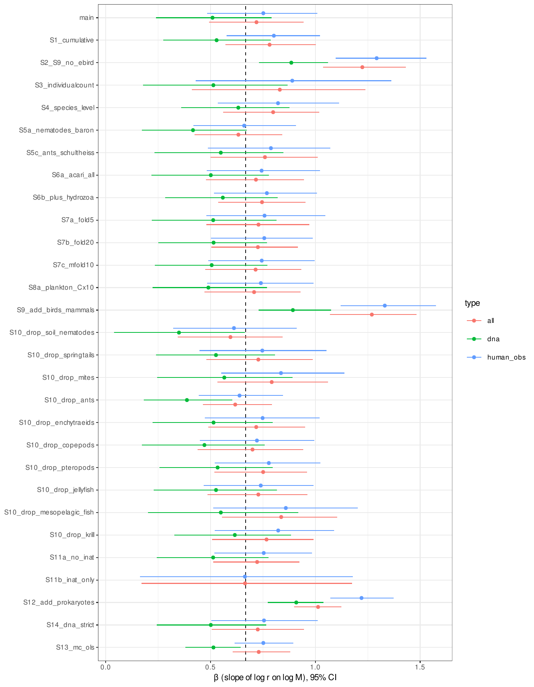
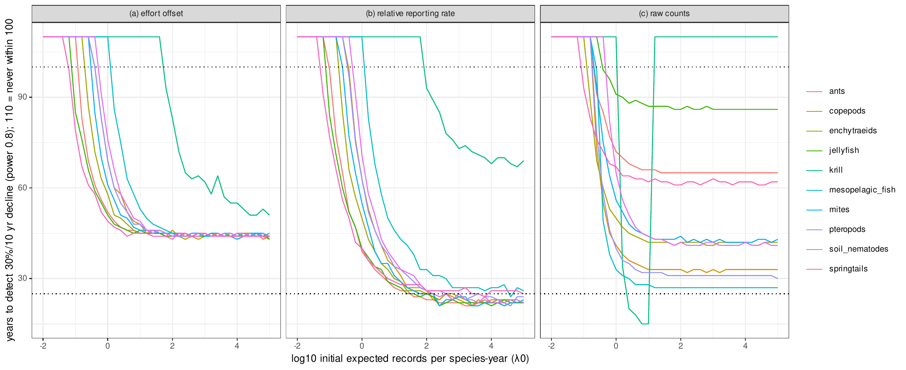
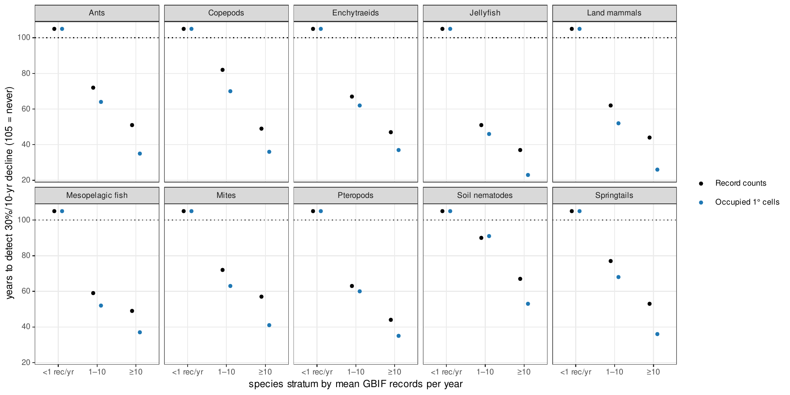
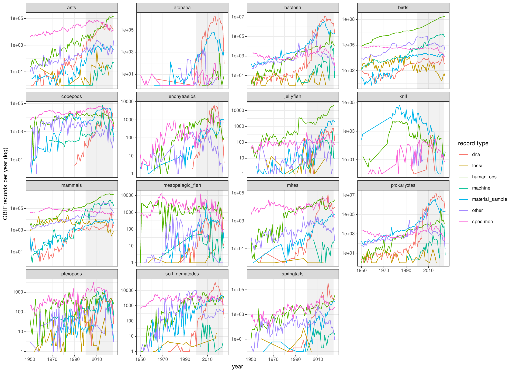
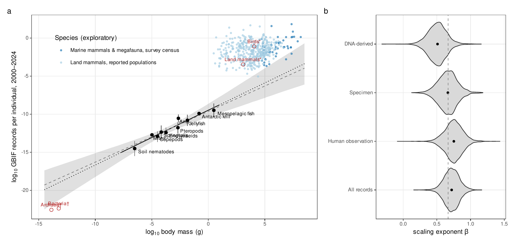

## Supplementary Figures

{width=100%}

**Fig. S1. Exponents of records per individual on body mass in the initial analysis.** Posterior medians and 95% credible intervals of the exponent β in the main analysis and in all sensitivity analyses, for all records, human observations and DNA-derived records; the S13 analysis uses Monte Carlo propagation with ordinary least squares. The dashed line marks 2/3. Because abundance and body mass are collinear across groups, the exponent is not identifiable from the records (Table S11).

{width=100%}

**Fig. S2. Initial detection simulations.** Years needed to detect a 30% decline per decade with power 0.8 against the initial expected number of records per species and year, for each group and the three analysis methods (negative binomial regression with an effort offset, binomial relative reporting rate, and negative binomial regression of raw counts), using the overdispersion estimated from mammal records (φ = 0.69) and each group's observed recording trajectory. A value of 110 denotes no detection within 100 years; dotted lines mark 25 and 100 years.

{width=100%}

**Fig. S3. Record counts versus occupied grid cells.** Years needed to detect a 30% decline per decade using annual record counts (black) or the annual number of occupied 1° grid cells (blue), by group and stratum of mean records per species and year. Overdispersion was estimated separately for each index, and the occupancy index was assumed to decline in proportion to abundance, which is optimistic. A value of 105 denotes no detection within 100 years.

{width=100%}

**Fig. S4. Annual GBIF records by group and record type.** Records per year from 1950 to 2025 (log scale) for each group, by record type (DNA-derived, human observation, specimen, machine observation, material sample and other). The shaded period (2000–2024) is the window analysed.

{width=100%}

**Fig. S5. Initial analysis of records per individual.** (*A*) Records per individual against body mass for the ten groups with independent censuses (black; fitted relationship with 95% credible band, and the slope of 2/3 as a dashed line), groups with occurrence- or allometry-derived censuses or DNA-only records (red open symbols, not fitted), and mammal species with census abundances (blue). (*B*) Posterior distributions of the exponent by record type. Records per individual largely mirror abundance (main text, Fig. 2).
