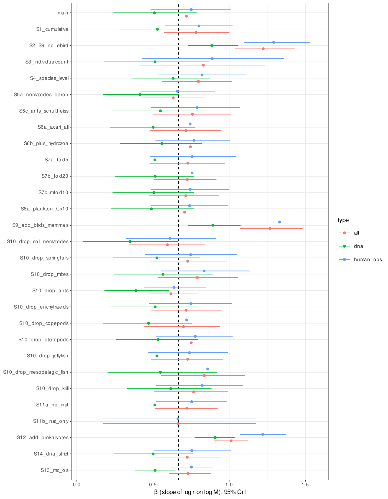
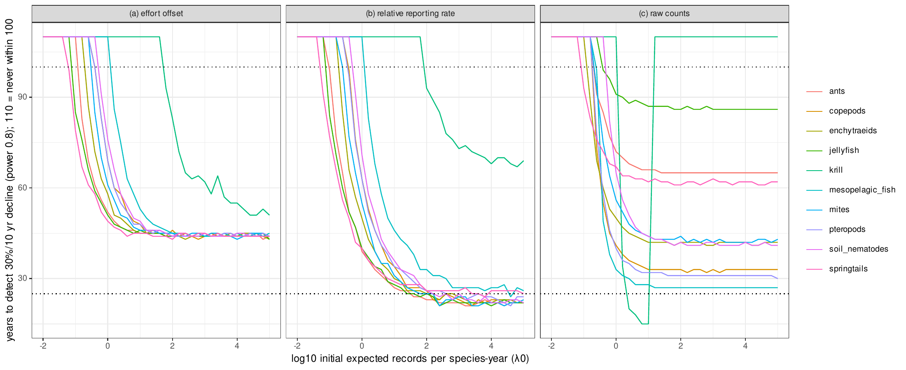
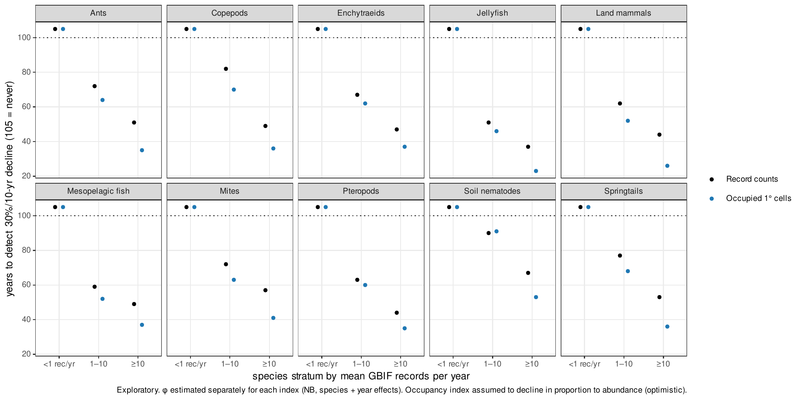
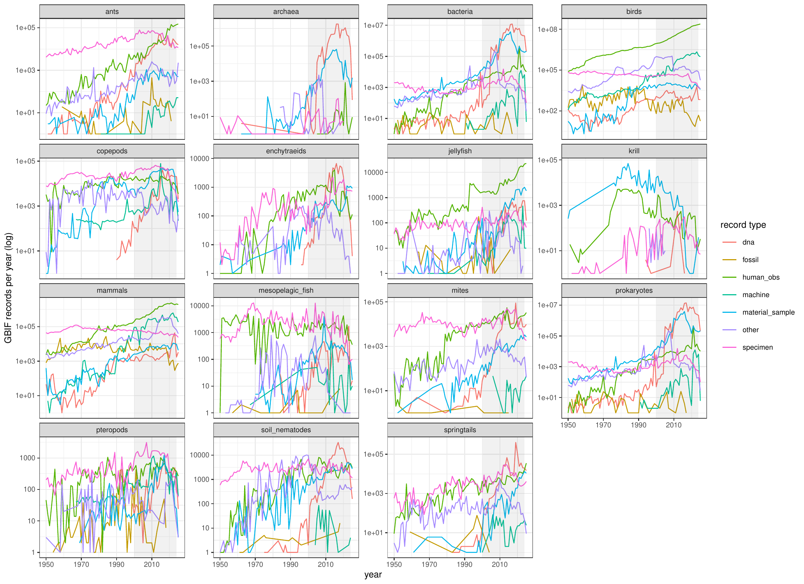
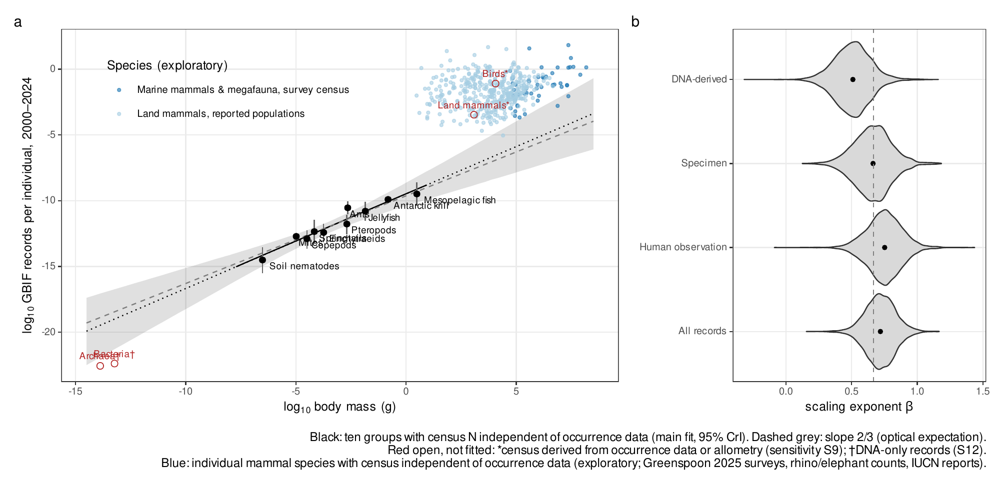

## Supplementary Methods

### 1. Preregistration and its limitations

The analysis plan (PREREG v1.0, Japanese original with an English translation in `PREREG_en.md`) was finalised at commit 01a2fe7 on 3 November 2026. It fixed the data versions, models, priors, decision criteria, exclusion rules and 15 sensitivity analyses.

**What was already known when the plan was written.** Before the plan was written, I had already inspected:
- the census values for each group
- the total GBIF records per group and their breakdown by record type

Records per individual and all regressions had not been computed.

**Repository history.** All commits, from setup to the first manuscript, are dated the same day. During review, the repository history was rewritten to remove files derived from the Living Planet Database, whose terms do not allow redistribution. Commits before 01a2fe7 were unaffected, so the preregistration commit is unchanged.

**Changes after finalisation.** All were appended to the plan with dates and reasons (Section 11). Peer review identified two problems with the plan itself:
- records per individual on body mass is not identifiable when abundance and mass are collinear
- the H3 mapping double-counted effort declines

Both are reported, and every analysis added in revision is labelled exploratory.

### 2. Census data

**Sources and classification.** Global abundance (N) and biomass (B) estimates were compiled with their sources, uncertainties and estimation methods (`docs/data_provenance.md`, verbatim quotations). Each was classified into one of four classes:
- **independent:** extrapolated from field samples, or from survey- or catch-based population models
- **occurrence-derived:** using citizen-science or occurrence data
- **allometry-derived:** density predicted from body mass or traits
- **mixed**

Birds [@callaghan2021pnas] were classed occurrence-derived because eBird data inform every species' density. For 92% of land mammal species, abundances in ref. [@greenspoon2023] come from a model with body mass among its predictors, so these were classed allometry-derived.

**The ten groups analysed.** Ten groups had independent estimates (Table S1):
- soil nematodes [@vandenhoogen2019]
- springtails [@potapov2023]
- soil mites, obtained by rerunning the code of ref. [@rosenberg2023] with a fixed seed
- non-arboreal ants [@rosenberg2023]
- Antarctic krill [@atkinson2009]
- enchytraeids, copepods, pteropods, planktonic cnidarians and mesopelagic fishes [@baron2018]

For the five Bar-On groups, abundance is biomass divided by an assumed individual mass. Biomass was realigned to the same subgroup, and the assumed mass entered the model as an observation.

**Unit conversion.** Wet mass used each source's factors (Rosenberg dry-to-wet ratios; the Potapov carbon-to-fresh equivalence) or a carbon-to-wet-mass ratio of 0.15 [@baron2018].

**Uncertainty.** Census uncertainties were converted to log-normal standard deviations:
- 95% intervals and ranges: (ln hi − ln lo)/3.92
- fold f: ln f/1.96
- otherwise a default fold of 10 (assumed masses: fold 3)

### 3. Occurrence records

**GBIF snapshot.** All records in the GBIF snapshot of 1 November 2026 were read from the AWS open-data bucket with the R package arrow (GBIF.org, https://doi.org/10.15468/dl.jeesns; 3,887,364,403 records). Absences and fossil specimens were excluded, leaving 3.75 × 10⁹ records. The records were aggregated three ways:
1. taxon × year × basis of record × dataset class
2. for the analysed groups and mammals, species × year × dataset × basis of record
3. unique sampling events (species × dataset × 0.1° cell × date)

The event count was used as an alternative response because some datasets publish one record per individual or per sequence variant (e.g. KRILLBASE).

**Dataset classes.** These were obtained from the GBIF API: eBird, iNaturalist research-grade, and datasets with the DNA-derived data extension. DNA-extension datasets were further classified from their titles and descriptions into three types (`data/derived/dna_dataset_types.csv`):
- specimen barcodes (the International Barcode of Life dataset)
- reference sequence databases (EUKARYOME, excluded from DNA comparisons)
- metabarcoding and environmental DNA (148 datasets)

**Taxonomic matching.** Census groups were matched to GBIF taxa (COL eXtended Release taxonomy) by explicit rules (Table S1). In revision, scope-corrected variants were defined (`docs/taxon_scope_variants.csv`; lists compiled during review):
- **mites:** excluding water-mite, plant-associated, animal-associated and stored-product families
- **nematodes:** excluding marine-dominated orders and animal-parasitic families and orders
- **mesopelagic fishes:** 15 families instead of Myctophidae only

**Described species.** Counts came from the Catalogue of Life (ChecklistBank dataset 316595), with Scyphozoa plus Cubozoa (297) for jellyfish. Alternative counts for mites (55,000) and nematodes (29,000) come from literature compilations (Table S20).

**Species-level names.** Census names were resolved to accepted names with the GBIF species-matching service.

### 4. Preregistered models

**Tier B (records per individual on body mass).** ln R_gk ~ Normal(ln N_g + a_k + b_k(ln M_g − c), √(τ_k² + 1/R_gk)). Latent ln N_g and ln M_g were informed by the census observations, four record types were fitted jointly, and the priors were b ~ N(0, 2), a ~ N(−25, 10) and τ ~ Half-Normal(0, 2). The 1/R term approximates Poisson variance; a Poisson likelihood mixed poorly in parameter-recovery tests at these counts.

**Tier A (mammals).** A Poisson–log-normal model with order effects for 388 species with reported population sizes. The measurement error on ln N and the residual were combined into one term with a centred parameterisation, after the planned brms implementation failed to converge. This is equivalent to the plan only with a flat prior on latent abundance.

**Detection simulations.** Annual counts were simulated as NegBin(λ₀E_te^(−dt), φ) with:
- φ estimated from report-based mammals using species and year fixed effects
- E_t, each group's observed record trajectory
- d, a 30% decline per decade

Three analysis methods were compared (effort-offset NB regression, binomial relative reporting rate, raw counts). T_detect was found by bisection.

### 5. Review-driven models of record allocation (exploratory)

**Free-coefficient model.** ln R_g ~ Normal(a + γ(ln N_g − c_N) + δ(ln M_g − c_M) + Xη, √(τ² + 1/R_g)), with latent N and M as above, fitted to all records only (no joint fitting of overlapping record types).
- **Covariates X:** log described species, and/or a soil-versus-marine indicator.
- **Priors:** N(0, 2) for γ, δ and η, with N(0, 5) in sensitivity.
- **Variants:**
  - responses: scope-corrected records; sampling events; records without the three largest datasets of each group
  - census alternatives: jellyfish mass ×50 for gelatinous carbon content; nematode carbon-to-fresh 0.105; krill abundance from unadjusted nets
- **Posterior predictive checks:** coverage of observed ln R by 95% prediction intervals.

**Ratio null.** Records were permuted among groups (5,000 times), and records-per-individual slopes were computed by OLS on point estimates.

**DNA contrast.** log(R_DNA/R_human) was regressed on log M, so that abundance cancels. Census uncertainty was propagated by Monte Carlo (4,000 draws) and the residual sampling uncertainty of the slope by t draws.

### 6. Detection: analytic results, overdispersion and simulations (exploratory unless stated)

**Analytic detection time.** For a log-linear decline at rate d observed for T years with residual variance σ² on the log scale, the slope's standard error is σ/√(T(T²−1)/12). For a negative binomial count with mean λ and shape φ, σ² ≈ 1/λ + 1/φ. Power 1 − β at one-sided α therefore requires

T(T² − 1)/12 = (1/λ + 1/φ)(z_α + z_β)²/d²,

which gives the floor T ≈ [12(z_α + z_β)²/(φd²)]^(1/3) as λ → ∞. Also reported (Table S15):
- the minimum decline per decade detectable within 10 years
- the share of the population lost by the time of detection

**Overdispersion net of trends.** For each species recorded at least once per year on average, three negative binomial regressions were fitted to annual records 2000–2024, all with an offset for the group's total records:
- intercept only
- linear trend
- quadratic trend

φ and the lag-1 autocorrelation of Pearson residuals were summarised by group, data source and record-rate stratum, with up to 200 species per stratum. Groups included eBird and non-eBird bird records, and mammal records with and without machine observations.

**Simulations with record-rate-dependent φ.** T_detect for a 30% decline per decade under constant effort was recomputed for each group, using the trend-removed φ of the record-rate stratum corresponding to λ₀ (31 values from 10⁻² to 10⁴, 500 replicates).

**Autocorrelation.** Latent log-normal year effects followed AR(1) with ρ = 0.44, with variance chosen so that the marginal overdispersion equalled φ = 0.69. These were analysed with the effort-offset method for stable and declining series.

### 7. Validation against structured monitoring (exploratory)

For 48 British butterfly species, two trend estimates for 2000–2019 were compared:
- **From GBIF:** unstructured records (UKBMS and the Wider Countryside Butterfly Survey removed; GBIF download https://doi.org/10.15468/dl.u8s7s5), analysed with the three methods.
- **From UKBMS:** site indices (2024 release; values of −2, which denote insufficient monitoring, treated as missing), using a quasi-Poisson GLM with site fixed effects and a linear year term.

2019 was the last year before the largest unstructured dataset ends. A trend was classed as significant at two-sided α = 0.05.

### 8. Detectability of described species (exploratory)

For every described species in each group, λ was the mean annual records 2015–2024, with λ = 0 for species without records. The time to detect a 30% decline per decade was read from the group's curve in Section 6 (taking the lower adjacent grid point, which is conservative). For mammals and birds, species with body masses (COMBINE [@soria2021]; AVONET [@tobias2022]) were binned by order of magnitude; birds used the eBird curve.

### 9. Other exploratory analyses retained from the first version

- **Vertebrates with survey-based censuses.** 50 mammal species, after removing a duplicated elephant entry and an unverified polar bear value. Compared with the extrapolated preregistered relationship (Table S7).
- **Occupancy index.** Occupied 1° cells per species and year, compared with record counts (Table S6, Fig. S3).
- **Multi-species indicators.** Pooled NB regressions of K species with independent noise.
- **Never-recorded species (H5).** Predicted from the observation model with literature totals of species richness. It shares those totals with the benchmark and over-predicts the number of recorded species by 4–11 times in four groups (Table S8), so it is reported as unsupported.

The Living Planet Database analysis of the first version was removed. It used an outdated public release, its data-use terms were uncertain, and indicators are not built from occurrence records.

### 10. Software, reproducibility and AI assistance

R 4.6.1 with renv, targets, cmdstanr (CmdStan 2.40), brms, arrow and tidyverse; seed 20261103. All figures and tables are generated by code in the public repository (https://github.com/hideyuki-doi/observation-inequality), which also contains the review reports and the response.

The work was carried out with Claude (Anthropic), an AI system, under the author's direction. The system wrote and ran code, retrieved and summarised literature and data documentation, and drafted text. The author approved each analysis stage at predefined gates and checked the results. Bibliographic entries were verified against Crossref or original documents. Census values were checked against source files, with verbatim quotations recorded.

### 11. Deviations from the preregistration

1. **Likelihood (implementation, before finalisation).** A Gaussian likelihood on ln R with variance τ² + 1/R was used instead of a Poisson likelihood.
2. **Species-level model (implementation).** The single combined error term described in Section 4 replaced brms with me(); it is equivalent only under a flat prior on latent abundance.
3. **Detection simulations (implementation).** T_detect was found by bisection, with a minimum T of 3. The denominator of the relative reporting rate was the group's other records. Failed fits counted as non-detections.
4. **H3 mapping (error disclosed in review).** λ₀ was scaled to the 2024 record rate while the effort trajectory started in 2000, which double-counts effort declines. This affects krill and mesopelagic fishes in the upper size third.
5. **H3 interpretation (addendum after results).** The criterion was met formally because detection failed in every size third, not because of a size gradient. H3 is reported as not substantively supported.
6. **Preregistered sensitivity analyses not run in the first version.** S5b (Rosenberg springtails), S6c (nematodes without parasitic families), S6d (extended mesopelagic families) and S15 (undescribed-species correction). S6c and S6d were run in revision as scope corrections (Table S20). S5b and S15 were not run.
7. **H1/H2 interpretation (review).** The records-per-individual exponent is not identifiable from the records (ratio artefact; Tables S11–S12). The preregistered decisions are reported but not interpreted as evidence about detection.
8. **Tier A consistency (preregistered check).** The within-mammal exponent (0.32) did not overlap the Tier B exponent (0.72). This was not reported in the first version.
9. **All revision analyses** are exploratory (Sections 5–8).

### Supplementary figures

{width=100%}

{width=100%}

{width=100%}

{width=100%}

{width=100%}
